# Remote Self-Control

[](https://github.com/Sat32blk/uc-remote-self-control/actions/workflows/test.yml)

A custom integration for the **Unfolded Circle Remote 3** (and Remote Two) that runs on the remote itself and lets the remote control **itself**:

- **Remote settings as entities:** button backlight level and color, display brightness and timeout, sleep timeout, wake sensitivity, Wake on LAN, sound effects and volume, haptics. Use them in activities, macros, pages, buttons and the touch slider.
- **Smart Controls:** buttons with if / else logic ("if the receiver is on, turn *it* up, otherwise the TV"), built in a browser page the integration serves itself.
- **State icons:** make a button on a page change its icon with a device's state, like a green power icon while the receiver is on. Pick the button, drop in an image per state.
- **Sliders & quick menus:** turn any number on your devices (receiver volume, a light, a blind) into a slider with the remote's own slider pop-up, and make pop-up menus whose choices run Smart Control steps (inputs, sound modes, scenes).
- **Return to previous activity:** a ↩ button (on screen or a physical button) that always takes you back to the activity you came from.

> [!WARNING]
> **Beta.** Tested on one Remote 3 so far. The integration changes your remote's settings, activities, pages and button mappings. **Back up your remote's configuration in the web configurator before installing**, so you can restore it if something goes wrong.

> Community project, not affiliated with Unfolded Circle. MIT licensed. It changes the remote's settings through the remote's local Core REST API.

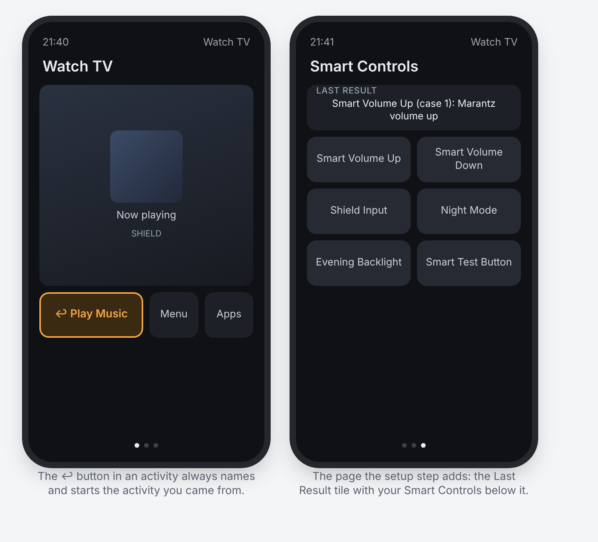

<p align="center">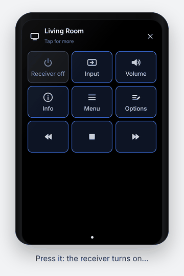</p>

*Illustration of what the integration adds to an activity. The screenshots below are of the real builder page, running against a test remote with example devices.*

## Contents

- [Install](#install)
- [Walkthroughs](#walkthroughs)
  1. [Your first Smart Control (2 minutes)](#1-your-first-smart-control-2-minutes)
  2. [Smart volume: receiver if it's on, otherwise the TV](#2-smart-volume-receiver-if-its-on-otherwise-the-tv)
  3. [Switch input, turning the receiver on first](#3-switch-input-turning-the-receiver-on-first)
  4. [Night Mode on a long press](#4-night-mode-on-a-long-press)
  5. [Backlight by time of day](#5-backlight-by-time-of-day)
  6. [Return to the previous activity](#6-return-to-the-previous-activity)
  7. [Display brightness on the touch slider](#7-display-brightness-on-the-touch-slider)
  8. [A power icon that turns green when the receiver is on](#8-a-power-icon-that-turns-green-when-the-receiver-is-on)
  9. [A receiver volume slider](#9-a-receiver-volume-slider)
  10. [A pop-up menu for the receiver's inputs](#10-a-pop-up-menu-for-the-receivers-inputs)
- [The builder](#the-builder)
- [Entities](#entities)
- [Rules reference](#rules-reference)
- [Security](#security) · [Configuration](#configuration) · [Logs and removal](#logs-and-removal) · [Development](#development) · [Changes](#changes) · [Support](#support)

## Install

1. **Back up your remote** in the web configurator and download the backup.
1. Download `uc-intg-self-control-<version>.tar.gz` from the [latest release](https://github.com/Sat32blk/uc-remote-self-control/releases/latest).
2. Web configurator → **Integrations → Add new → Install custom** → choose the file.
3. Start the setup for **Remote Self-Control**. The first screen is information only. On the second, enter the **web-configurator PIN** and leave the address at `127.0.0.1`.
   - The integration uses the PIN once to create an API key named "Self-Control <date>" and stores only that key.
   - If setup fails with a connection error, run it again with the remote's own IP address.
4. Add the entities you want to the integration, then use them in activities, macros or pages.

To update, use Install custom with **Update existing driver** checked. Your Smart Controls and settings are kept. No restart of the remote is needed.

## Walkthroughs

### 1. Your first Smart Control (2 minutes)

The integration starts with one control, **Smart Test Button**, which moves the button backlight to the next color.

1. Integrations → Remote Self-Control → add **Smart Test Button** and **Smart Controls: Last Result**.
2. Integrations → Remote Self-Control → **Configure** → **Add the Last Result tile to an activity** → pick an activity, leave *Also add the Smart Control buttons* ticked.
3. Open that activity on the remote and swipe to the new **Smart Controls** page. Press **Smart Test Button**: the backlight changes color and the Last Result tile says what happened.

That tile is your debugging friend: every Smart Control writes what it did (or why it failed) there.

### 2. Smart volume: receiver if it's on, otherwise the TV

One pair of volume buttons that follows whatever is actually playing.

1. Open the builder: `http://<remote-name>.local:10123/` (the exact address is in Integrations → Remote Self-Control → Configure). Log in with the web-configurator PIN.
2. **Add from a template… → Smart volume (receiver, else TV)**. The builder fills in your first two media players; change them in the dropdowns if needed.
3. It reads: **If** *Receiver* state *is* ON → *Receiver* volume up. **Otherwise** → *TV* volume up.

   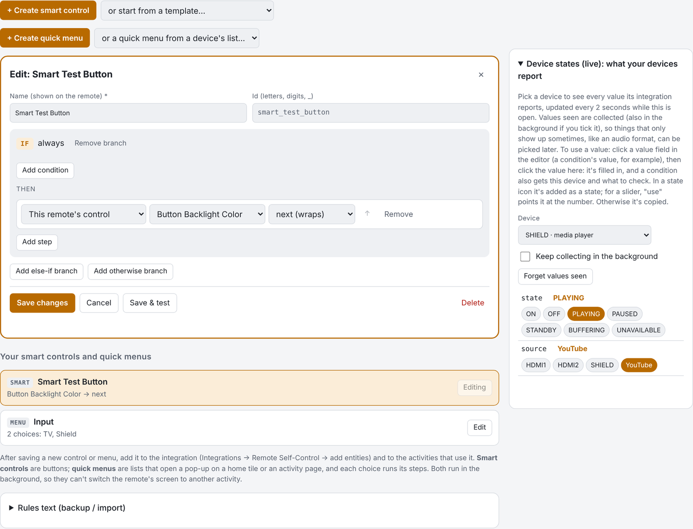

4. Press **Test** to run it once on the remote. The **Last test** panel shows what it did:

   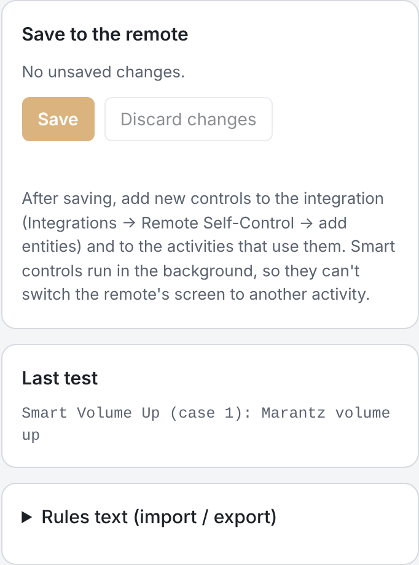

5. Add the template again, rename it *Smart Volume Down* and pick *volume down* in both branches, then **Save**.
6. Integrations → Remote Self-Control → add both new controls.
7. In your activity: add them to the activity's devices, then **Button mapping** → *Volume up* → **Smart Volume Up** (*push*), *Volume down* → **Smart Volume Down**.

### 3. Switch input, turning the receiver on first

Receivers often ignore an input change while they're still booting. A **Wait until** step fixes that.

1. **Add from a template… → Switch input, turning the device on first**, pick your receiver and the input.
2. It reads: **If** *Receiver* is not OFF → select input. **Otherwise** → turn on, **wait until** it's not OFF (up to 10 s), wait 1 s more, then select input.

   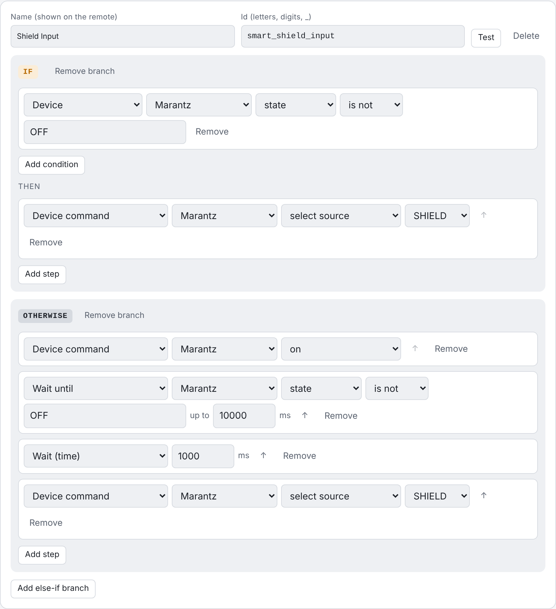

3. **Save**, add the control to the integration, and put it on a page or a button. Great for "watch" buttons on a page of app shortcuts.

### 4. Night Mode on a long press

Dim everything for movie night with one press, and get your exact previous settings back with the next.

1. **Add from a template… → Night Mode (toggle, restores your settings)**.
2. It **remembers** the current backlight, display and sound settings, then sets a red backlight at 10 %, display 30 % and sound effects off. A second press **restores** what was there before.

   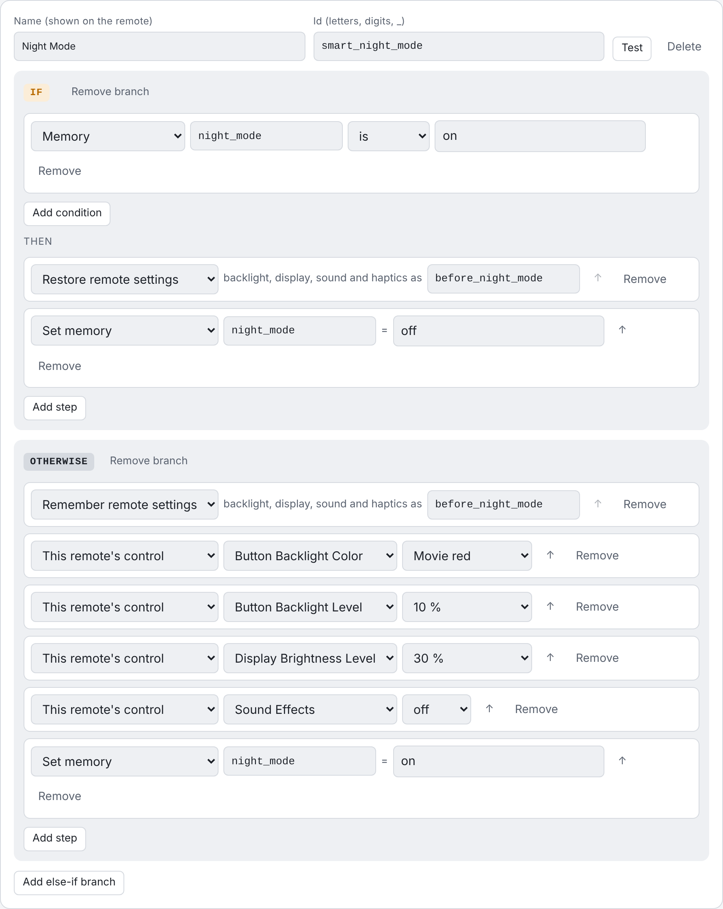

3. **Save**, add **Night Mode** to the integration, then in an activity's **Button mapping** give it a long press (for example *long press Menu*).

**Quiet Mode** works the same way for sound effects and haptics.

### 5. Backlight by time of day

1. **Add from a template… → Backlight by time of day**.
2. **If** the time is between 20:00 and 07:00 → backlight *Amber* at 30 %; **otherwise** *Cool white* at 100 %.

   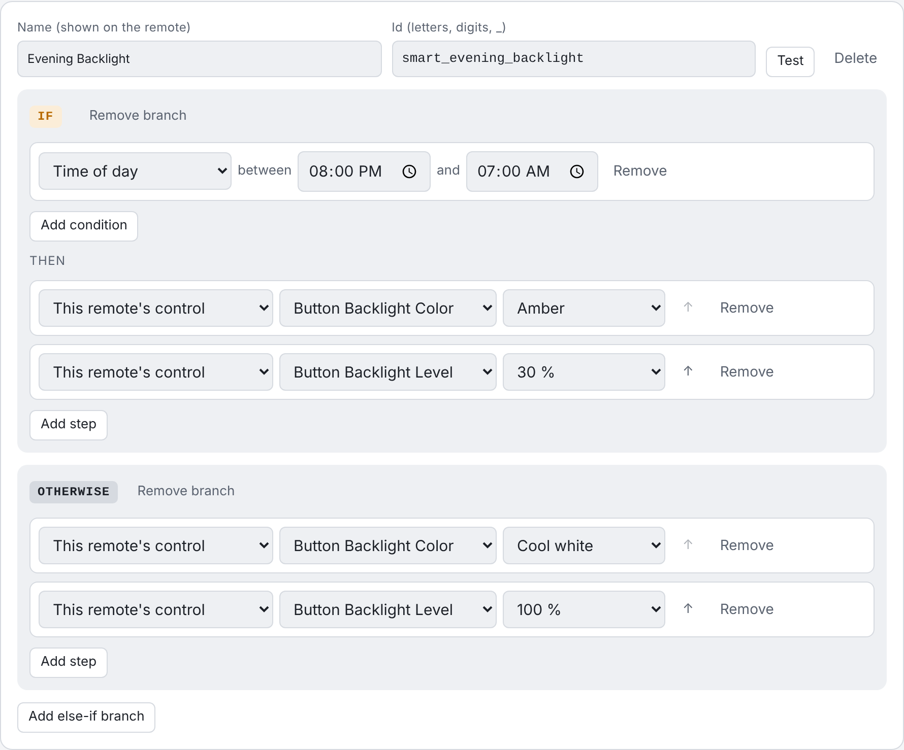

3. Add it to your activities' **on sequence** so the remote's buttons match the time of day every time you start watching.

### 6. Return to the previous activity

Jump from *Watch TV* to a *Home Assistant* or *Music* activity and back with one press, whether or not the first activity was turned off.

1. Integrations → Remote Self-Control → **Configure** → **Return to previous activity: set up the ↩ button**.
2. Tick the activities that should have the button.
3. Choose the **on-screen button**: a text button "↩ <previous activity>" or a back-arrow icon. It's added to the first free spot of each activity's first page; move it wherever you like in the web configurator. A text button needs two free cells side by side; with only one, the icon is used. **The page's grid is never changed**: if there's no free spot, nothing is added (important for pages built from tiled pictures).
4. Optionally choose a **physical button** (short or long press), used **in every ticked activity** or **only where the on-screen button doesn't fit**. It replaces what that button does in those activities.

From then on the integration keeps every ↩ button pointed at the activity you came from:

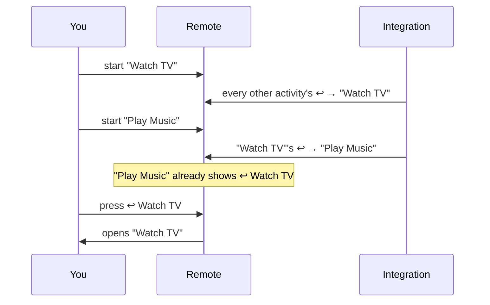

Why it works this way: the remote only switches screens when *you* press a button that starts an activity. An integration can't switch screens, so instead it rewrites the ↩ buttons ahead of time. While you're in one activity, the ↩ buttons in all the others already point to it.

Limit: the remote reports an activity "starting" only when it goes from off to on. Reopening an activity that's still on (for example with ↩) isn't seen, so ↩ toggles between the last two activities you started.

### 7. Display brightness on the touch slider

1. Integrations → Remote Self-Control → add **Display Brightness** (and/or **Button Backlight**).
2. In an activity's user-interface settings, set the **touch slider** to **Display Brightness**.
3. Slide to set the screen brightness. It turns display auto brightness off; *off* means the dimmest level.

### 8. A power icon that turns green when the receiver is on

State icons make a button on a page follow a device's state. The button's own icon or text is the **default** look; you drop in an image (and/or type a label) for each state.

1. Put a button on the page of a **single-page** activity, for example a gray power icon or a text button "Receiver". This is what it shows when the receiver is off.
2. Open the builder and switch to the **Icons & Sliders** tab → **+ Create state icon**, and give it a name.
3. **The button:** pick the activity, then click the button in the drawing of its page.
4. **What it shows:** pick the device (your receiver) and what to check (*state*). The builder shows its value right now.
5. **Looks:** for *ON*, drag in a green power image (any PNG, JPG or SVG; it's resized to 90×90 and uploaded to the remote) and optionally a label like "Receiver ON". Add more states if you like (*STANDBY*, an input name, …).
6. **Save.** Within about 2 seconds of the receiver turning on, the button shows the green icon; when it turns off it goes back to its default. What the button does when pressed doesn't change.

<p align="center"></p>

Setting it up in the builder:

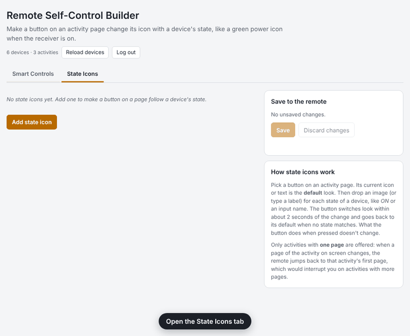

**Caveats**

- **Single-page activities only.** On the remote, changing a page of the activity you're looking at sends you back to that activity's first page when it has more than one page. So the builder only lets you pick activities with exactly one page; activities with more pages are listed but greyed out.
- **If you add a second page later**, the state icon stops updating (it's never forced on a multi-page activity) and the builder shows a warning on it. Remove the extra page, or remove the state icon.
- **Only icon and text buttons** can change. Media player widgets, sensor tiles and lists can't be used.
- **About 2 seconds' delay**: the integration checks the device every 2 seconds while the remote is awake. While the remote sleeps nothing is checked; the button catches up within a couple of seconds after it wakes.
- **The default look is captured when you save.** If you later change that button's icon or text in the web configurator, delete the state icon and add it again so it learns the new look. Don't move the button to another spot; the integration finds it by its position.
- **Uploaded images stay on the remote** as custom icons (named `si_…`) after you delete a state icon. Delete them in the web configurator if you don't need them.

### 9. A receiver volume slider

A slider is a light entity of this integration that stands for a number on another device. Its brightness (0–100 %) maps to the range you choose, so the remote's own slider pop-up and the Remote 3 touch slider work with it.

1. In the builder, open the **Icons & Sliders** tab → **+ Create slider**, and give it a name.
2. **Device:** pick your receiver. The builder fills in the rest for you: it reads the **volume**, sends it with the **volume** command, range 0–100. Lower **Highest** if you never want it louder (e.g. 60).
   - For a device without a "set volume" command (IR, or only volume up/down), choose **Press up / down commands**: pick the up and down commands, how much one press changes it, and the pause between presses. Without anything to read it from, the slider remembers the last value it set.
3. **Save**, then type a value under **Try a value** and press **Set** to check it.
4. Integrations → Remote Self-Control → add the new slider (group **Remote Sliders & Menus**).
5. Put it on a **home page**: tapping the tile opens the slider pop-up. On a Remote 3 you can also set an activity's **touch slider** to it.
6. Optional: pick a **tile icon** (step 4 on the slider card) and press **Show its level on a page…** to add a live level graphic (below).

The slider follows changes made elsewhere (within about 2 seconds while the remote is awake). Switching the slider **off** sets the lowest value; **on** goes back to the last value. When you drag quickly, the newest position wins: values in between are skipped instead of queued.

**Custom graphics.** The slider pop-up itself is drawn by the remote and can't be restyled, but two things can:

- **Tile icon:** 12 icons (volume, speaker, subwoofer, light bulb, brightness, blinds, temperature, fan, knob, equalizer, microphone, list) for the slider's or menu's tile on home pages and in lists. Pick one on the card; it's uploaded to the remote and set once the entity has been added to the integration.
- **Live level graphic:** a button on an activity page whose image shows the current value: bar, column, arc gauge, ring, dots, signal, speaker, knob, tank, thermometer, equalizer or segments, in 6 colors. It's a state icon of the kind *Level graphic*: 11 images (0 %, 10 % … 100 %) are made in the builder and uploaded when you save, and the button shows the one closest to the value. Same limits as state icons: **single-page activities only**, about 2 seconds' delay. What the button does when pressed doesn't change (map it to the slider's toggle or volume up, for example).

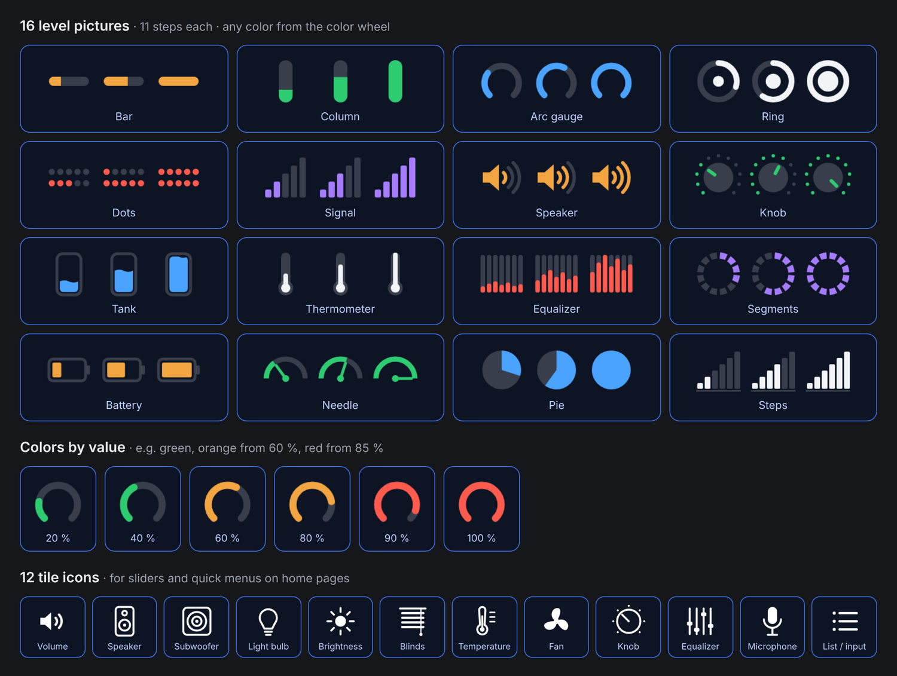

### 10. A pop-up menu for the receiver's inputs

A quick menu is a list entity whose choices each run steps, the same steps as a Smart Control.

1. In the **Smart Controls** tab, open **or a quick menu from a device's list…** and pick *Receiver: Select source*. You get one choice per input, each switching the receiver to it and marked as current while the receiver is on that input.
2. Rename the menu and the choices ("TV", "Shield", …), remove the ones you don't use, and add steps if you like (turn the receiver on first, set the volume, change the backlight color, …).
3. **Save**, then press **Run** on a choice to try it.
4. Add the menu to the integration, and put it on a home page or an activity page: it opens the remote's list pop-up; picking a choice runs it.

**Step through on a button:** in the menu's **Step through the choices with a button** section, pick an activity, a physical button and short or long press. Each press then runs the next choice (choice 1, then 2, then 3 …) and, with *start over at the first* ticked, goes back to choice 1 after the last. Add the menu to the integration before saving this; the integration maps the button and adds the menu to the activity's devices. Removing the button from the menu unmaps it again.

Choices without a *current when* condition show as current after you pick them. **+ Create quick menu** starts an empty menu for anything else, for example scenes that set lights, inputs and volume together.

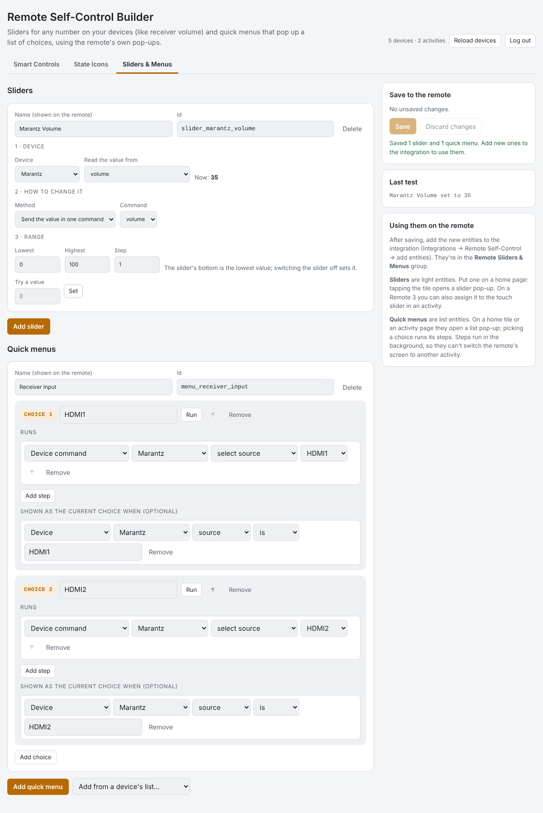

## The builder

The integration serves its own builder page on your network, at `http://<remote-name>.local:10123/` or `http://<remote-ip>:10123/`. The exact addresses are shown in Integrations → Remote Self-Control → Configure.

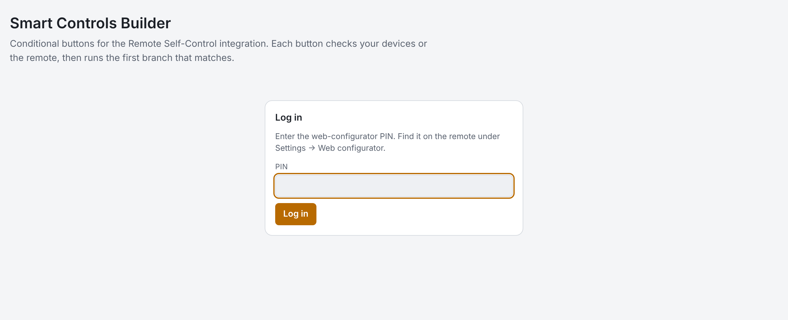

- **Log in** with the web-configurator PIN.
- **Pick, don't type:** the builder lists your remote's own devices with their commands, inputs and sound modes, your activities, and the remote's own controls and settings.
- **If / Else if / Otherwise** branches, each with conditions and steps. The first matching branch runs.
- **Templates** for the remote itself (Night Mode, Quiet Mode, color cycle, brighter/dimmer, backlight by time) and for your devices (smart volume, play/pause or turn on, input with wait, sound mode cycle, action per activity).
- **Create, then list:** each tab starts with its **+ Create** button. It opens an editor box for the new item; a **name is required**. After **Save**, the item shows below as one bar with its name, what it does and an **Edit** button that opens its settings again (with **Delete** inside).
- **Save** writes to the remote (everything is checked first; errors are listed in the editor). **Save & test** runs a smart control once and shows the result.
- **Rules text** exports and imports everything as JSON, for backups and sharing.
- Works on phones and in dark mode, and needs no internet: everything is served by the remote.

| Dark mode | Phone |
|---|---|
| 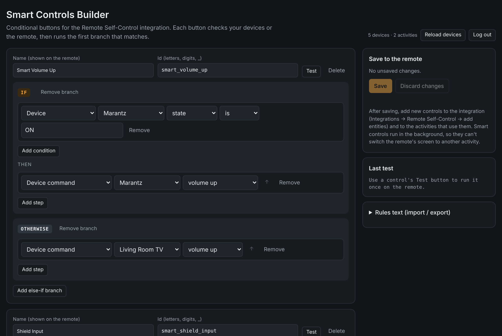 | 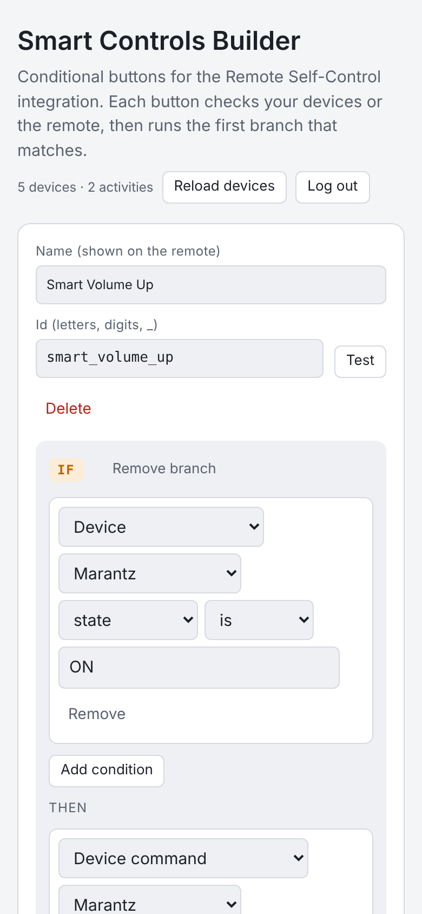 |

After saving, add new controls to the integration (Integrations → Remote Self-Control → add entities) and to the activities that use them. Smart Controls run in the background, so they can't switch the remote's screen to another activity (use the ↩ button for that).

Without a browser, the same JSON can be pasted in the integration's setup screen (*Edit Smart Controls (text)*).

### Examples

- `examples/remote-only-rules.json`: Night Mode, Quiet Mode, color cycle, brighter/dimmer. Works on any remote.
- `examples/shield-tv-receiver-rules.json`: device rules for an NVIDIA Shield, a Samsung TV and a Marantz receiver (smart volume, play/pause, input with wait, sound mode cycle). Replace the `YOUR_…_ID` placeholders in `aliases` with your own entity ids, or rebuild them from the builder's templates.

## Entities

Grouped by area in the web configurator.

| Group | Entity | Type | What it controls |
|---|---|---|---|
| **Remote Display** | Display Brightness Level | select | 10 % … 100 % (turns display auto brightness off) |
| | Display Brightness | light | brightness for the **touch slider**; off = dimmest |
| | Display Timeout | select | 5 s … 60 s |
| | Display Auto Brightness | switch | display follows the light sensor |
| **Remote Buttons** | Button Backlight Level | select | Off, 10 % … 100 % |
| | Button Backlight Color | select | 12 presets (Warm white … Cool white) |
| | Button Backlight | light | on/off, brightness, color |
| | Button Backlight Auto | switch | backlight turns on by itself in a dark room |
| **Remote Settings** | Sound Effects Volume | select | 0 % … 100 % |
| | Wake Sensitivity | select | Off, Low, Medium, High |
| | Sleep Timeout | select | 1 min … 3 h, Never |
| | Wake on LAN | switch | Wi-Fi wake |
| | Sound Effects | switch | on/off |
| | Haptic Feedback | switch | on/off |
| **Remote Navigation** | Previous Activity | sensor | name of the activity used before the current one |
| *(builder)* | State icons | page buttons | icon/label follows a device's state (single-page activities) |
| **Remote Sliders & Menus** | (your sliders) | light | slider pop-up / touch slider for a number on a device |
| | (your quick menus) | select | list pop-up; each choice runs steps |
| **Remote Smart Controls** | (your Smart Controls) | button | press to run |
| | Smart Controls: Last Result | sensor | what the last Smart Control did, or its error |

Tips:

- In macros, activities and UI buttons, prefer the **select** entities ("Select option"). The remote's editor passes the light's "brightness %" and "color" commands through unconverted, so they are unreliable there.
- A UI button's entity must also be in that activity's devices, otherwise the web configurator says "Invalid request. Check your input."
- The web configurator doesn't list **sensor** entities when you edit an activity. Use *Configure → Add the Last Result tile to an activity* for the Last Result tile; the ↩ button already shows the previous activity's name.

## Rules reference

```json
{
  "aliases": { "receiver": "uc_denon_driver.main.media_player.YOUR_RECEIVER_ID" },
  "buttons": [
    {
      "id": "smart_volume_up",
      "name": "Smart Volume Up",
      "cases": [
        { "if": { "entity": "receiver", "is": "ON" },
          "do": [ { "cmd": "media_player.volume_up", "entity": "receiver" } ] },
        { "else": [ { "cmd": "media_player.volume_up", "entity": "samsungtv_driver.main.media_player.YOUR_TV_ID" } ] }
      ]
    }
  ]
}
```

| Condition | Example |
|---|---|
| Device | `{ "entity": "tv", "attr": "source", "is": "HDMI2" }` (`is`, `is_not`, `in`, `not_in`, `>`, `<`, `>=`, `<=`, `contains`) |
| Activity | `{ "activity_on": "<activity id>" }` |
| Time | `{ "time_between": ["22:00", "06:00"] }` |
| This remote's control | `{ "control": "backlight_color", "is": "Movie red" }` |
| This remote's setting | `{ "setting": "display.brightness", ">": 50 }` |
| Memory | `{ "var": "night_mode", "is": "on" }` |
| Combine | `{ "all": [ … ] }`, `{ "any": [ … ] }`, `{ "not": … }` |

| Step | Example |
|---|---|
| Device command | `{ "cmd": "media_player.select_source", "entity": "receiver", "params": { "source": "SHIELD" } }` |
| IR / simple command | `{ "cmd": "DIMMER", "entity": "receiver" }` |
| This remote's control | `{ "self": "display_level", "option": "up" }`, `{ "self": "haptic", "state": "toggle" }` |
| Wait | `{ "delay": 500 }` |
| Wait until | `{ "wait_until": { "entity": "receiver", "is": "ON" }, "timeout": 10000 }` |
| Memory | `{ "set_var": "night_mode", "to": "on" }` |
| Remember / restore settings | `{ "save_settings": "before" }`, `{ "restore_settings": "before" }` |
| Stop | `{ "stop": true }` |

For lists, `option` can also be `next` / `previous` (wraps around) or `up` / `down` (stops at the ends). The short form `{ "id", "name", "if", "do", "else" }` works too. Limits: 30 controls, 8 branches each, 12 steps per branch, 30 s per run. A press while the same control is still running is ignored.

## Security

- The builder requires the web-configurator PIN. The PIN is checked against the remote and never stored. A session lasts 12 hours (HttpOnly, SameSite=Strict cookie).
- After 5 wrong PINs from one address, logins are blocked for 5 minutes.
- The builder is plain HTTP on your local network, like the web configurator itself. Don't forward port 10123 to the internet.
- The integration holds an admin API key for the remote. Removing the integration does not revoke it: list keys with `GET /api/auth/api_keys` and delete with `DELETE /api/auth/api_keys/{id}`.

## Configuration

| Environment variable | Default | Purpose |
|---|---|---|
| `UC_SELF_BUILDER_PORT` | `10123` | Port of the builder page |
| `UC_SELF_RETURN_POLL_MS` | `2000` | How often activity states (↩ button), state-icon devices, slider values and menu conditions are read |
| `UC_SELF_SLIDER_HOLD_MS` | `3000` | After you move a slider, device reports are ignored this long so a slow device can't jump it back |

Files in the integration's config folder: `self_control.json` (address + API key), `smart_rules.json` (your rules; absent = defaults), `smart_vars.json` (remembered values), `return.json` (↩ settings and activity history), `state_icons.json` (state icons and each button's default look), `sliders_menus.json` (sliders, quick menus and their last values).

## Logs and removal

- Logs: web configurator → Settings → Development → Logs (lines start with `[self-control]`).
- Remove: delete the integration instance, then the driver, then revoke the API key (see Security). ↩ buttons and Smart Controls pages that were added to activities stay until you delete them.

## Development

```
src/driver.json                         metadata and first setup screen
src/bin/driver.js                       entities, commands, setup flow, polling
src/bin/core.js                         REST client for the remote's Core API
src/bin/smart.js                        Smart Controls: validation and engine
src/bin/web.js                          builder web server and device catalog
src/bin/web/builder.html                builder page (no external files; works offline)
src/bin/tile.js                         puts the Last Result tile on an activity page
src/bin/returnbtn.js                    return to previous activity (tracking + ↩ buttons)
src/bin/stateicons.js                   state icons (watch devices, switch button looks)
src/bin/extras.js                       virtual sliders and quick menus
src/bin/default-rules.json              default Smart Controls (Smart Test Button)
examples/                               example rules
test/                                   fake Core API + Integration-API test client
```

Tests (Node 22):

```
npm install                 # dev dependency: ws
(cd src/bin && npm install)
npm test                    # settings, Smart Controls + builder API, return button, state icons, sliders & menus
```

Build the install archive:

```
./build.sh                  # -> dist/uc-intg-self-control-<version>.tar.gz
```

Built on the [Integration API](https://github.com/unfoldedcircle/integration-node-library) and the [Core REST API](https://github.com/unfoldedcircle/core-api) by Unfolded Circle.

## Changes

- **0.6.0:** **New builder layout**: a *+ Create* button per tab opens an editor box (name required); saved items are listed as bars with what they do and an *Edit* button. Two tabs: *Smart Controls* (smart controls and quick menus) and *Icons & Sliders* (state icons and sliders). ↩ buttons no longer add a row to a full page (that resized every button and broke picture-tile pages); new option to use the physical button only where the on-screen button doesn't fit. **Sliders & quick menus**. 12 tile icons for sliders and menus, and **level graphics** (12 designs × 6 colors) as a new kind of state icon that shows a number as a bar, gauge, dots and more. Sliders are light entities mapped to a number on any device (one "set value" command, or repeated up/down presses), with the remote's slider pop-up on home tiles and the Remote 3 touch slider; they follow the device's value. Quick menus are select entities whose choices run Smart Control steps, with an optional condition that marks the current choice; *Add from a device's list* builds one from a device's inputs or sound modes.
- **0.5.0:** **State icons**: new *State Icons* tab in the builder. Pick a button on a single-page activity, a device and what to check, then drop an image and/or type a label per state; the button switches look within about 2 seconds and returns to its own look otherwise. Images are resized to 90×90 and uploaded to the remote. Builder renamed *Remote Self-Control Builder* with *Smart Controls* and *State Icons* tabs.
- **0.4.0:** Return to previous activity: tracks the activities you start and keeps a ↩ text or icon button and/or a physical button pointed at the previous one, set up in the integration's Configure menu. New Previous Activity sensor (area Remote Navigation). Smart Control results name devices instead of showing entity ids.
- **0.3.2:** new **Display Brightness** light entity so the Remote 3 touch slider can set the display brightness.
- **0.3.1:** setup option "Add the Last Result tile to an activity".
- **0.3.0:** Smart Controls are generic: starts with one Smart Test Button; remote-only templates; builder page served by the integration with PIN login, device list, templates, save and test; remember / restore settings; next / previous / up / down; IR simple commands.
- 0.2.0: Smart Buttons: conditional rules, last-result sensor, rule editor in the setup screen.
- 0.1.x: remote settings entities, grouped into Remote Display / Remote Buttons / Remote Settings; macro-friendly selects.

## Support

If this integration makes your remote more fun to use, you can buy me a coffee. Thank you! ☕

<p align="center">
  <a href="https://buymeacoffee.com/sat32blk"></a>
</p>
