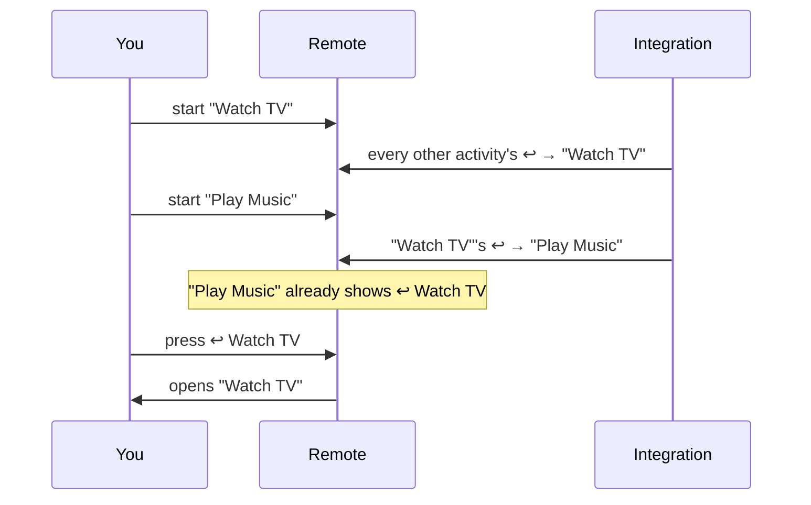

# Remote Self-Control

[](https://github.com/Sat32blk/uc-remote-self-control/actions/workflows/test.yml)

A custom integration for the **Unfolded Circle Remote 3** (and Remote Two) that runs on the remote itself and lets the remote control **itself**:

- **Remote settings as entities:** button backlight level and color, display brightness and timeout, sleep timeout, wake sensitivity, Wake on LAN, sound effects and volume, haptics. Use them in activities, macros, pages, buttons and the touch slider.
- **Smart Controls:** buttons with if / else logic ("if the receiver is on, turn *it* up, otherwise the TV"), built in a browser page the integration serves itself.
- **Return to previous activity:** a ↩ button (on screen or a physical button) that always takes you back to the activity you came from.

> Community project, not affiliated with Unfolded Circle. MIT licensed. It changes the remote's settings through the remote's local Core REST API.


*Illustration of what the integration adds to an activity. The screenshots below are of the real builder page, running against a test remote with example devices.*

## Contents

- [Install](#install)
- [Walkthroughs](#walkthroughs)
  1. [Your first Smart Control (2 minutes)](#1-your-first-smart-control-2-minutes)
  2. [Smart volume: receiver if it's on, otherwise the TV](#2-smart-volume-receiver-if-its-on-otherwise-the-tv)
  3. [Switch input, turning the receiver on first](#3-switch-input-turning-the-receiver-on-first)
  4. [Night Mode on a long press](#4-night-mode-on-a-long-press)
  5. [Backlight by time of day](#5-backlight-by-time-of-day)
  6. [Return to the previous activity](#6-return-to-the-previous-activity)
  7. [Display brightness on the touch slider](#7-display-brightness-on-the-touch-slider)
- [The builder](#the-builder)
- [Entities](#entities)
- [Rules reference](#rules-reference)
- [Security](#security) · [Configuration](#configuration) · [Logs and removal](#logs-and-removal) · [Development](#development) · [Changes](#changes)

## Install

1. Download `uc-intg-self-control-<version>.tar.gz` from the [latest release](https://github.com/Sat32blk/uc-remote-self-control/releases/latest).
2. Web configurator → **Integrations → Add new → Install custom** → choose the file.
3. Start the setup for **Remote Self-Control**. The first screen is information only. On the second, enter the **web-configurator PIN** and leave the address at `127.0.0.1`.
   - The integration uses the PIN once to create an API key named "Self-Control <date>" and stores only that key.
   - If setup fails with a connection error, run it again with the remote's own IP address.
4. Add the entities you want to the integration, then use them in activities, macros or pages.

To update, use Install custom with **Update existing driver** checked. Your Smart Controls and settings are kept. No restart of the remote is needed.

## Walkthroughs

### 1. Your first Smart Control (2 minutes)

The integration starts with one control, **Smart Test Button**, which moves the button backlight to the next color.

1. Integrations → Remote Self-Control → add **Smart Test Button** and **Smart Controls: Last Result**.
2. Integrations → Remote Self-Control → **Configure** → **Add the Last Result tile to an activity** → pick an activity, leave *Also add the Smart Control buttons* ticked.
3. Open that activity on the remote and swipe to the new **Smart Controls** page. Press **Smart Test Button**: the backlight changes color and the Last Result tile says what happened.

That tile is your debugging friend: every Smart Control writes what it did (or why it failed) there.

### 2. Smart volume: receiver if it's on, otherwise the TV

One pair of volume buttons that follows whatever is actually playing.

1. Open the builder: `http://<remote-name>.local:10123/` (the exact address is in Integrations → Remote Self-Control → Configure). Log in with the web-configurator PIN.
2. **Add from a template… → Smart volume (receiver, else TV)**. The builder fills in your first two media players; change them in the dropdowns if needed.
3. It reads: **If** *Receiver* state *is* ON → *Receiver* volume up. **Otherwise** → *TV* volume up.

   

4. Press **Test** to run it once on the remote. The **Last test** panel shows what it did:

   

5. Add the template again, rename it *Smart Volume Down* and pick *volume down* in both branches, then **Save**.
6. Integrations → Remote Self-Control → add both new controls.
7. In your activity: add them to the activity's devices, then **Button mapping** → *Volume up* → **Smart Volume Up** (*push*), *Volume down* → **Smart Volume Down**.

### 3. Switch input, turning the receiver on first

Receivers often ignore an input change while they're still booting. A **Wait until** step fixes that.

1. **Add from a template… → Switch input, turning the device on first**, pick your receiver and the input.
2. It reads: **If** *Receiver* is not OFF → select input. **Otherwise** → turn on, **wait until** it's not OFF (up to 10 s), wait 1 s more, then select input.

   

3. **Save**, add the control to the integration, and put it on a page or a button. Great for "watch" buttons on a page of app shortcuts.

### 4. Night Mode on a long press

Dim everything for movie night with one press, and get your exact previous settings back with the next.

1. **Add from a template… → Night Mode (toggle, restores your settings)**.
2. It **remembers** the current backlight, display and sound settings, then sets a red backlight at 10 %, display 30 % and sound effects off. A second press **restores** what was there before.

   

3. **Save**, add **Night Mode** to the integration, then in an activity's **Button mapping** give it a long press (for example *long press Menu*).

**Quiet Mode** works the same way for sound effects and haptics.

### 5. Backlight by time of day

1. **Add from a template… → Backlight by time of day**.
2. **If** the time is between 20:00 and 07:00 → backlight *Amber* at 30 %; **otherwise** *Cool white* at 100 %.

   

3. Add it to your activities' **on sequence** so the remote's buttons match the time of day every time you start watching.

### 6. Return to the previous activity

Jump from *Watch TV* to a *Home Assistant* or *Music* activity and back with one press, whether or not the first activity was turned off.

1. Integrations → Remote Self-Control → **Configure** → **Return to previous activity: set up the ↩ button**.
2. Tick the activities that should have the button.
3. Choose the **on-screen button**: a text button "↩ <previous activity>" or a back-arrow icon. It's added to the first free spot of each activity's first page; move it wherever you like in the web configurator.
4. Optionally choose a **physical button** (short or long press). It replaces what that button does in the ticked activities.

From then on the integration keeps every ↩ button pointed at the activity you came from:



Why it works this way: the remote only switches screens when *you* press a button that starts an activity. An integration can't switch screens, so instead it rewrites the ↩ buttons ahead of time. While you're in one activity, the ↩ buttons in all the others already point to it.

Limit: the remote reports an activity "starting" only when it goes from off to on. Reopening an activity that's still on (for example with ↩) isn't seen, so ↩ toggles between the last two activities you started.

### 7. Display brightness on the touch slider

1. Integrations → Remote Self-Control → add **Display Brightness** (and/or **Button Backlight**).
2. In an activity's user-interface settings, set the **touch slider** to **Display Brightness**.
3. Slide to set the screen brightness. It turns display auto brightness off; *off* means the dimmest level.

## The builder

The integration serves its own builder page on your network, at `http://<remote-name>.local:10123/` or `http://<remote-ip>:10123/`. The exact addresses are shown in Integrations → Remote Self-Control → Configure.


- **Log in** with the web-configurator PIN.
- **Pick, don't type:** the builder lists your remote's own devices with their commands, inputs and sound modes, your activities, and the remote's own controls and settings.
- **If / Else if / Otherwise** branches, each with conditions and steps. The first matching branch runs.
- **Templates** for the remote itself (Night Mode, Quiet Mode, color cycle, brighter/dimmer, backlight by time) and for your devices (smart volume, play/pause or turn on, input with wait, sound mode cycle, action per activity).
- **Save** writes to the remote (rules are checked first; errors are listed). **Test** runs one control once and shows the result.
- **Rules text** exports and imports everything as JSON, for backups and sharing.
- Works on phones and in dark mode, and needs no internet: everything is served by the remote.

| Dark mode | Phone |
|---|---|
|  |  |

After saving, add new controls to the integration (Integrations → Remote Self-Control → add entities) and to the activities that use them. Smart Controls run in the background, so they can't switch the remote's screen to another activity (use the ↩ button for that).

Without a browser, the same JSON can be pasted in the integration's setup screen (*Edit Smart Controls (text)*).

### Examples

- `examples/remote-only-rules.json`: Night Mode, Quiet Mode, color cycle, brighter/dimmer. Works on any remote.
- `examples/shield-tv-receiver-rules.json`: device rules for an NVIDIA Shield, a Samsung TV and a Marantz receiver (smart volume, play/pause, input with wait, sound mode cycle). Replace the `YOUR_…_ID` placeholders in `aliases` with your own entity ids, or rebuild them from the builder's templates.

## Entities

Grouped by area in the web configurator.

| Group | Entity | Type | What it controls |
|---|---|---|---|
| **Remote Display** | Display Brightness Level | select | 10 % … 100 % (turns display auto brightness off) |
| | Display Brightness | light | brightness for the **touch slider**; off = dimmest |
| | Display Timeout | select | 5 s … 60 s |
| | Display Auto Brightness | switch | display follows the light sensor |
| **Remote Buttons** | Button Backlight Level | select | Off, 10 % … 100 % |
| | Button Backlight Color | select | 12 presets (Warm white … Cool white) |
| | Button Backlight | light | on/off, brightness, color |
| | Button Backlight Auto | switch | backlight turns on by itself in a dark room |
| **Remote Settings** | Sound Effects Volume | select | 0 % … 100 % |
| | Wake Sensitivity | select | Off, Low, Medium, High |
| | Sleep Timeout | select | 1 min … 3 h, Never |
| | Wake on LAN | switch | Wi-Fi wake |
| | Sound Effects | switch | on/off |
| | Haptic Feedback | switch | on/off |
| **Remote Navigation** | Previous Activity | sensor | name of the activity used before the current one |
| **Remote Smart Controls** | (your Smart Controls) | button | press to run |
| | Smart Controls: Last Result | sensor | what the last Smart Control did, or its error |

Tips:

- In macros, activities and UI buttons, prefer the **select** entities ("Select option"). The remote's editor passes the light's "brightness %" and "color" commands through unconverted, so they are unreliable there.
- A UI button's entity must also be in that activity's devices, otherwise the web configurator says "Invalid request. Check your input."
- The web configurator doesn't list **sensor** entities when you edit an activity. Use *Configure → Add the Last Result tile to an activity* for the Last Result tile; the ↩ button already shows the previous activity's name.

## Rules reference

```json
{
  "aliases": { "receiver": "uc_denon_driver.main.media_player.YOUR_RECEIVER_ID" },
  "buttons": [
    {
      "id": "smart_volume_up",
      "name": "Smart Volume Up",
      "cases": [
        { "if": { "entity": "receiver", "is": "ON" },
          "do": [ { "cmd": "media_player.volume_up", "entity": "receiver" } ] },
        { "else": [ { "cmd": "media_player.volume_up", "entity": "samsungtv_driver.main.media_player.YOUR_TV_ID" } ] }
      ]
    }
  ]
}
```

| Condition | Example |
|---|---|
| Device | `{ "entity": "tv", "attr": "source", "is": "HDMI2" }` (`is`, `is_not`, `in`, `not_in`, `>`, `<`, `>=`, `<=`, `contains`) |
| Activity | `{ "activity_on": "<activity id>" }` |
| Time | `{ "time_between": ["22:00", "06:00"] }` |
| This remote's control | `{ "control": "backlight_color", "is": "Movie red" }` |
| This remote's setting | `{ "setting": "display.brightness", ">": 50 }` |
| Memory | `{ "var": "night_mode", "is": "on" }` |
| Combine | `{ "all": [ … ] }`, `{ "any": [ … ] }`, `{ "not": … }` |

| Step | Example |
|---|---|
| Device command | `{ "cmd": "media_player.select_source", "entity": "receiver", "params": { "source": "SHIELD" } }` |
| IR / simple command | `{ "cmd": "DIMMER", "entity": "receiver" }` |
| This remote's control | `{ "self": "display_level", "option": "up" }`, `{ "self": "haptic", "state": "toggle" }` |
| Wait | `{ "delay": 500 }` |
| Wait until | `{ "wait_until": { "entity": "receiver", "is": "ON" }, "timeout": 10000 }` |
| Memory | `{ "set_var": "night_mode", "to": "on" }` |
| Remember / restore settings | `{ "save_settings": "before" }`, `{ "restore_settings": "before" }` |
| Stop | `{ "stop": true }` |

For lists, `option` can also be `next` / `previous` (wraps around) or `up` / `down` (stops at the ends). The short form `{ "id", "name", "if", "do", "else" }` works too. Limits: 30 controls, 8 branches each, 12 steps per branch, 30 s per run. A press while the same control is still running is ignored.

## Security

- The builder requires the web-configurator PIN. The PIN is checked against the remote and never stored. A session lasts 12 hours (HttpOnly, SameSite=Strict cookie).
- After 5 wrong PINs from one address, logins are blocked for 5 minutes.
- The builder is plain HTTP on your local network, like the web configurator itself. Don't forward port 10123 to the internet.
- The integration holds an admin API key for the remote. Removing the integration does not revoke it: list keys with `GET /api/auth/api_keys` and delete with `DELETE /api/auth/api_keys/{id}`.

## Configuration

| Environment variable | Default | Purpose |
|---|---|---|
| `UC_SELF_BUILDER_PORT` | `10123` | Port of the builder page |
| `UC_SELF_RETURN_POLL_MS` | `2000` | How often activity states are read for the ↩ button |

Files in the integration's config folder: `self_control.json` (address + API key), `smart_rules.json` (your rules; absent = defaults), `smart_vars.json` (remembered values), `return.json` (↩ settings and activity history).

## Logs and removal

- Logs: web configurator → Settings → Development → Logs (lines start with `[self-control]`).
- Remove: delete the integration instance, then the driver, then revoke the API key (see Security). ↩ buttons and Smart Controls pages that were added to activities stay until you delete them.

## Development

```
src/driver.json                         metadata and first setup screen
src/bin/driver.js                       entities, commands, setup flow, polling
src/bin/core.js                         REST client for the remote's Core API
src/bin/smart.js                        Smart Controls: validation and engine
src/bin/web.js                          builder web server and device catalog
src/bin/web/builder.html                builder page (no external files; works offline)
src/bin/tile.js                         puts the Last Result tile on an activity page
src/bin/returnbtn.js                    return to previous activity (tracking + ↩ buttons)
src/bin/default-rules.json              default Smart Controls (Smart Test Button)
examples/                               example rules
test/                                   fake Core API + Integration-API test client
```

Tests (Node 22):

```
npm install                 # dev dependency: ws
(cd src/bin && npm install)
npm test                    # settings, Smart Controls + builder API, return button
```

Build the install archive:

```
./build.sh                  # -> dist/uc-intg-self-control-<version>.tar.gz
```

Built on the [Integration API](https://github.com/unfoldedcircle/integration-node-library) and the [Core REST API](https://github.com/unfoldedcircle/core-api) by Unfolded Circle.

## Changes

- **0.4.0:** Return to previous activity: tracks the activities you start and keeps a ↩ text or icon button and/or a physical button pointed at the previous one, set up in the integration's Configure menu. New Previous Activity sensor (area Remote Navigation). Smart Control results name devices instead of showing entity ids.
- **0.3.2:** new **Display Brightness** light entity so the Remote 3 touch slider can set the display brightness.
- **0.3.1:** setup option "Add the Last Result tile to an activity".
- **0.3.0:** Smart Controls are generic: starts with one Smart Test Button; remote-only templates; builder page served by the integration with PIN login, device list, templates, save and test; remember / restore settings; next / previous / up / down; IR simple commands.
- 0.2.0: Smart Buttons: conditional rules, last-result sensor, rule editor in the setup screen.
- 0.1.x: remote settings entities, grouped into Remote Display / Remote Buttons / Remote Settings; macro-friendly selects.
