# Remote Self-Control

[](https://github.com/Sat32blk/uc-remote-self-control/actions/workflows/test.yml)

A custom integration for the **Unfolded Circle Remote 3** (and Remote Two) that runs on the remote itself. It started as a way to change the button backlight and the screen brightness from a button or a macro. It has grown into a second way to set up your remote: a **Page Editor** that edits activities, pages, buttons, sequences, macros, the home screen and devices on a picture of your remote, plus things the remote can't do on its own, like buttons with if / else logic, icons that follow a device's state, sliders for any number, and a ↩ button back to the previous activity.

Everything runs on the remote and is set up in a browser page the integration serves itself: no PC, server or cloud needed.

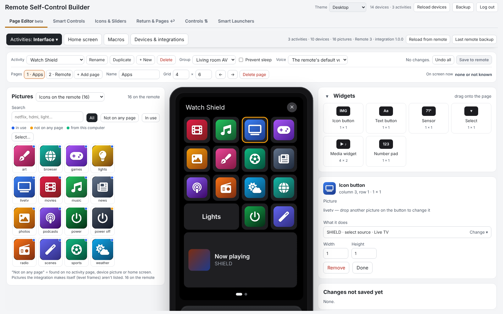

> [!WARNING]
> **Back up your remote's configuration in the web configurator before installing.** The integration changes your remote's settings, activities, pages, button mappings and more. The Page Editor keeps a copy of your activities, macros and home screen before its first change of a visit, but that's not a full backup. Tested on one Remote 3 so far.

> Community project, not affiliated with Unfolded Circle. MIT licensed. It works through the remote's local Core REST API.

## Contents

- [Features](#features)
  - [Page Editor](#page-editor): [activities and pages](#activities-and-pages) · [start and stop, with a guided setup](#start-and-stop-with-a-guided-setup) · [activity groups](#activity-groups) · [home screen](#home-screen) · [macros](#macros) · [devices, integrations and app links](#devices-integrations-and-app-links) · [themes](#themes) · [safe saving](#safe-saving)
  - [Smart Controls](#smart-controls) · [State icons](#state-icons) · [Sliders, quick menus and level pictures](#sliders-quick-menus-and-level-pictures) · [Controls](#controls) · [Return ↩ and page jumps](#return--and-page-jumps) · [Smart Launchers](#smart-launchers) · [The remote's own settings](#the-remotes-own-settings) · [Device states](#device-states) · [Backup, restore and Integration Manager](#backup-restore-and-integration-manager)
- [Install](#install)
- [Walkthroughs](#walkthroughs): 15 step-by-step examples, from your first Smart Control to the Page Editor
- [The builder](#the-builder) · [Entities](#entities) · [Rules reference](#rules-reference)
- [Security](#security) · [Configuration](#configuration) · [Logs and removal](#logs-and-removal) · [Development](#development) · [Changes](#changes) · [Support](#support)

## Features

### Page Editor

The builder's first tab shows your Remote 3 or Remote Two (picked from the remote's model number) and lets you edit what's on it. Nothing is written until you press a save button, and the integration keeps a copy of your activities, macros and home screen from before the first change of each visit (**Last copy before changes** downloads it). It isn't a full remote backup: the remote stops every integration while it makes one, so make that in the web configurator.

#### Activities and pages

- **Drag and drop.** The **Pictures** window sits beside the remote, as tall as it, with as many pictures per row as the page has columns; long lists scroll inside it. Pick **Icons on the remote**, **Built-in icons** (the remote's own, drawn as on the remote), **Channel icons**, **Level pictures & state icons** (the ones this integration made) or **Local folder** (pictures on your computer, shrunk and uploaded when you save).
- **Widgets:** text button, sensor, select, media widget and number pad.
- **What it does:** click a button and pick a device (the activity's own come first), then its command, or search with a few words (*shield movies*). **Custom value** sends a typed value such as an app link; **Not added yet** adds a device your integrations offer straight from there.
- **Physical keys and the touch slider:** click them on the drawing to set short and long presses.
- **Pages:** add, rename, change the grid, move, delete. **Activities:** rename, duplicate, delete or make a new one; activity group, prevent sleep and voice assistant.

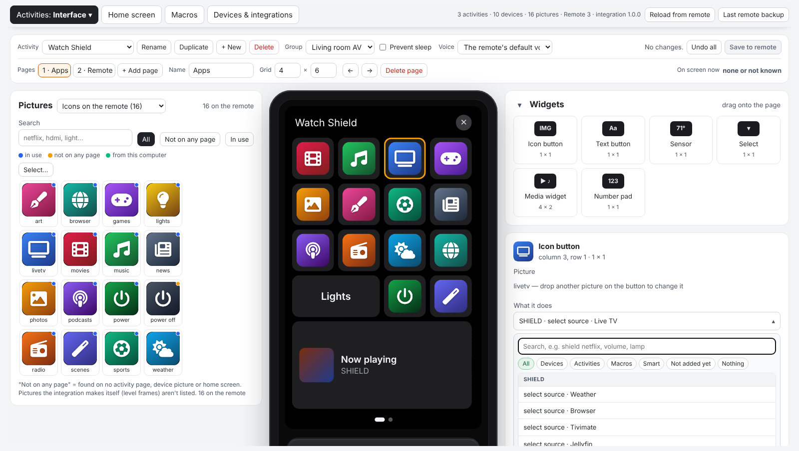

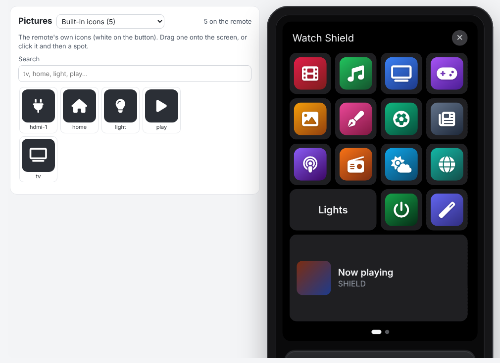

#### Start and stop, with a guided setup

The start and off sequences with readiness check and what happens when a command fails, and the devices in the activity.

When you give a button a command of a device that isn't in the sequences yet (or use **+ Add a device…**), a short setup asks what kind of device it is (display, AV receiver, streaming device, amp / subwoofer, Home Assistant, other), then a few questions for that kind (input, app, turn off at the end). Its steps go into the sequences in signal-flow order with recommended waits, and your other steps aren't moved:

- **on:** display → 1.5 s → sources → 2 s → receiver + input → 3 s → amps
- **off:** amps → 1 s → receiver → 1 s → display → 0.5 s → sources

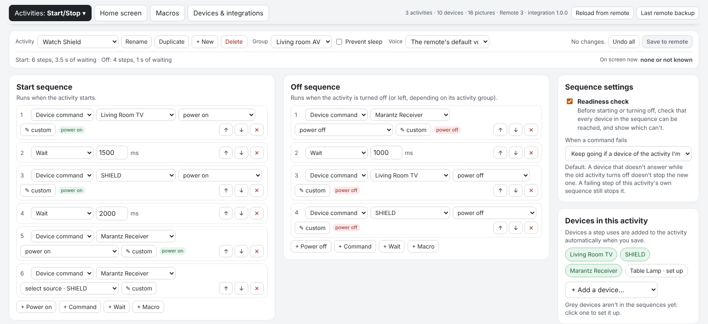

| What kind of device is it? | Then a few questions for that kind |
|---|---|
| 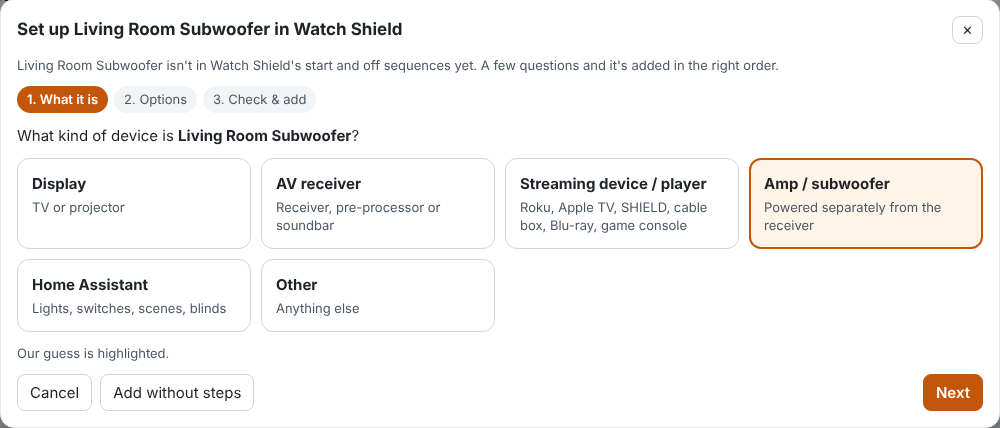 | 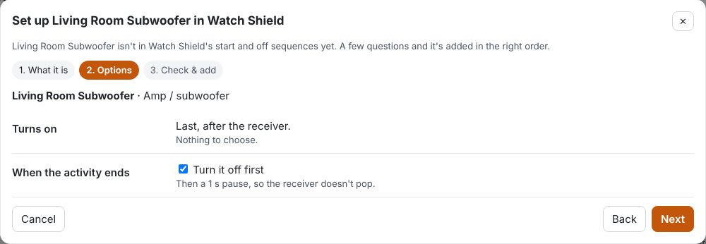 |

#### Activity groups

What switching between activities of a group turns off, as one plain sentence, with the steps and a grid of every switch in the group.

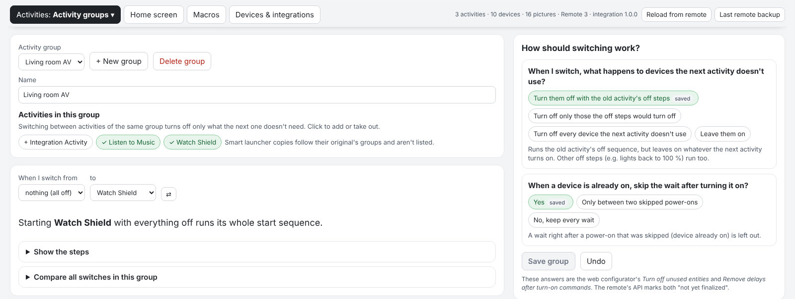

#### Home screen

Your home pages with their tiles and background pictures (the remote's own, or one from your computer). Drag activities, devices and groups into a page.

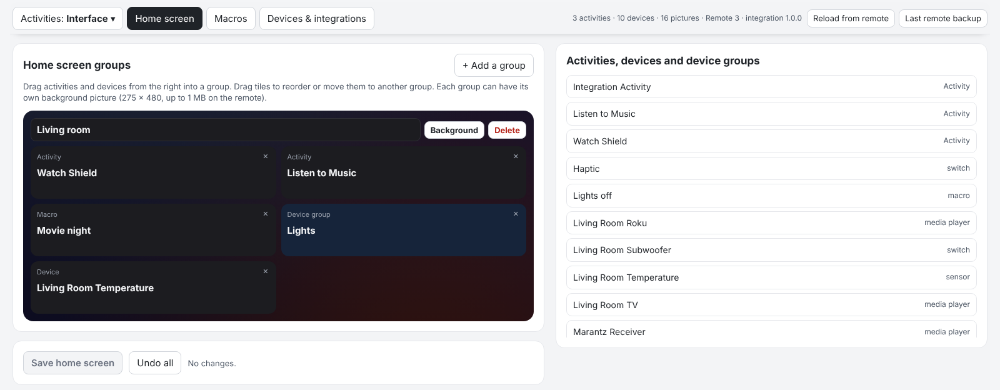

#### Macros

Steps with a check that each device answers, duplicate, delete (it says where the macro is used first) and **Try it now**.

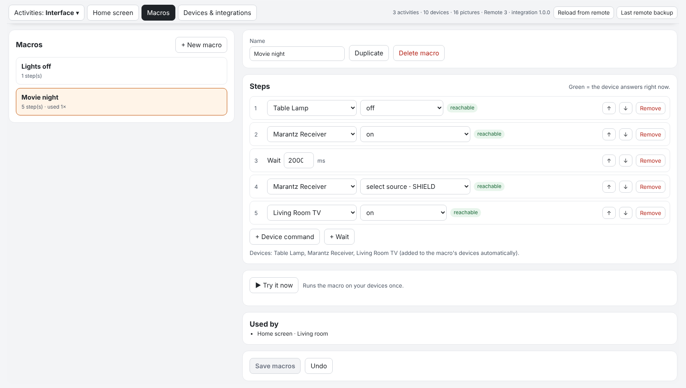

#### Devices, integrations and app links

Per integration: what's on the remote and what it offers to add (**Add** adds it at once), remove, rename, enable / disable and reconnect. **+ Add an integration** opens [Integration Manager](https://github.com/JackJPowell/uc-intg-manager) if you have it, otherwise the web configurator.

**App links** (Android TV): load a text file with one `market://launch?id=… = Name` per line. The apps show by name in What it does, the sequences and the guided setup ("select source · Tivimate"), and buttons that already use a link show its name. Apps the device already lists aren't added twice. Since a Google Play Store change, `market://launch?id=…` links no longer open apps on Android TV; put the app's own deep link in the file instead (for example `https://www.paramountplus.com/ = Paramount+`). You can find an app's deep link with `adb shell cmd package dump <package>` (under *Schemes*), or in the [Home Assistant deep-link guide](https://community.home-assistant.io/t/android-tv-remote-app-links-deep-linking-guide/567921).

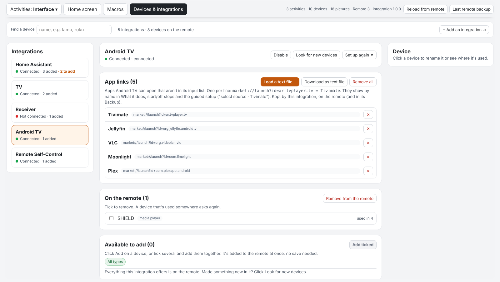

#### Themes

A **Theme** picker for the whole builder: Automatic, Desktop, Dark mode, Remote style, Midnight blue, High contrast.

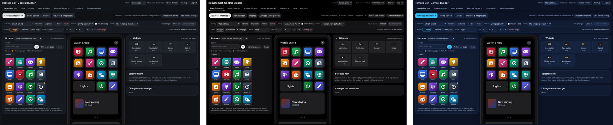

#### Safe saving

- **Pages are read again before saving.** A button you didn't touch keeps what the remote has now, so a picture the integration (state icons, level pictures) or the web configurator changed meanwhile isn't overwritten. Only changed pages, keys and settings are written.
- **The activity on the remote's screen** is saved once you leave it (changing a page you're looking at would jump to page 1); **Save pages now anyway** doesn't wait.
- If a picture from your computer can't be uploaded, nothing is saved.
- Activities made by an integration, and Smart Launcher copies, are locked (🔒).
- The editor reaches the remote only through the builder's login, and only for what it needs: API keys, system commands (reboot, update, power), the remote's settings and deleting whole collections are refused.

### Smart Controls

Buttons with **if / else if / otherwise** logic, built by picking from your own devices, activities and the remote's settings: "if the receiver is on, turn *it* up, otherwise the TV". Conditions on device states, the activity that's on, the time, the remote's settings and battery, and remembered values. Steps can run commands (IR too), wait, **wait until** a device is ready, remember and restore settings, and **jump to a page**. Templates for Night Mode, Quiet Mode, smart volume, input with wait and more; **Test** runs one on the remote and shows what it did. [Walkthroughs 1–5](#walkthroughs)


### State icons

A button on a page that changes its picture or label with a device's state, like a green power icon while the receiver is on. Pick the button on a drawing of the page, drop in a picture per state. [Walkthrough 8](#8-a-power-icon-that-turns-green-when-the-receiver-is-on)

<p align="center"></p>

### Sliders, quick menus and level pictures

- **Sliders:** any number on a device (receiver volume, a light, a blind, even IR up / down) as a slider with the remote's own slider pop-up and the Remote 3 touch slider.
- **Quick menus:** a pop-up list whose choices run steps: inputs, sound modes, scenes. Build one from a device's input list in one click.
- **Level pictures:** a button that shows a level in 16 designs (bar, arc gauge, battery, needle, …), in any color, changing color with the value, always or only for a few seconds after it changes. 12 tile icons for sliders and menus.

[Walkthroughs 9–10](#9-a-receiver-volume-slider)


### Controls

Press a switch and the volume rocker and touch slider change something else for a moment (a light, a tone control, the screen or backlight brightness, one of your sliders), with the remote's own volume pop-up. Per activity, what they do when no control is on; optionally **borrow** the rocker from your TV only while a control is on. [Walkthrough 11](#11-the-volume-keys-and-touch-slider-for-a-light-controls)

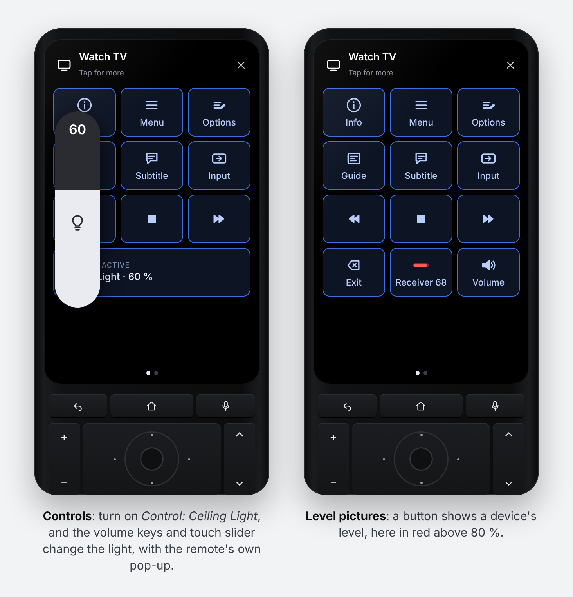

### Return ↩ and page jumps

- **↩ Return to the previous activity:** an on-screen button (text, arrow or your own picture) and/or a physical button that always takes you back to the activity you came from, optionally turning off the one you leave. [Walkthrough 6](#6-return-to-the-previous-activity)
- **Go to page:** a step that jumps to a page of the activity you're in, with logic ("if the Shield is playing → Apps, otherwise → Remote"). **Start pages:** per activity, the page it opens on depending on your devices. [Walkthrough 13](#13-jump-to-a-page-and-start-pages)


### Smart Launchers

One button (on a page, a physical button or the home screen) that opens the activity your conditions pick: *if the Shield is on → Watch ShieldTV, otherwise → Watch RokuTV*, optionally with extra steps once it has started. [Walkthrough 14](#14-one-button-for-whichever-activity-fits-smart-launchers)

### The remote's own settings

Button backlight level and color, display brightness and timeout, auto brightness, sleep timeout, wake sensitivity, Wake on LAN, sound effects and volume, and haptics, as entities you can use in activities, macros, pages, buttons and on the touch slider. See [Entities](#entities).

### Device states

A live panel with every value your devices (and the remote itself, battery included) report, with all values seen so far. Click a value to put it into a condition, a state icon or a slider.

### Backup, restore and Integration Manager

- **Builder → Backup:** one file with everything you set up, plus the pictures it uses. Restore picks the parts and checks them all before changing anything.
- **Reconfigure → Back up settings / Restore settings from a backup:** the same settings as text. [Integration Manager](https://github.com/JackJPowell/uc-intg-manager)'s **Backup Config** uses this, so it can keep your settings with its other backups.
- **Remove everything** puts back what the integration changed on your remote before you uninstall it.

[Walkthrough 12](#12-back-up-everything)

## Install

1. **Back up your remote** in the web configurator and download the backup.
2. Install the integration:
   - with [Integration Manager](https://github.com/JackJPowell/uc-intg-manager): find **Remote Self-Control** in its list of available integrations (once it has been added there) and install it; or
   - download `uc-intg-self-control-<version>.tar.gz` from the [latest release](https://github.com/Sat32blk/uc-remote-self-control/releases/latest), then web configurator → **Integrations → Add new → Install custom** → choose the file.
3. Start the setup for **Remote Self-Control**. The first screen is information only. On the second, enter the **web-configurator PIN** and leave the address at `127.0.0.1`.
   - The integration uses the PIN once to create an API key named "Self-Control <date>" and stores only that key.
   - If setup fails with a connection error, run it again with the remote's own IP address.
4. Open the builder at `http://<remote-name>.local:10123/` (the exact address is in Integrations → Remote Self-Control → Configure) and log in with the same PIN. The **Page Editor** opens first.
5. For the remote settings, Smart Controls, sliders and so on: add the entities you want to the integration, then use them in activities, macros or pages.

To update, first save a **Backup** in the builder (walkthrough 12), then use Install custom with **Update existing driver** checked (or update in Integration Manager). Your settings are kept. No restart of the remote is needed.

## Walkthroughs

### 1. Your first Smart Control (2 minutes)

The integration starts with one control, **Smart Test Button**, which moves the button backlight to the next color.

1. Integrations → Remote Self-Control → add **Smart Test Button** and **Smart Controls: Last Result**.
2. Integrations → Remote Self-Control → **Configure** → **Add the Last Result tile to an activity** → pick an activity, leave *Also add the Smart Control buttons* ticked.
3. Open that activity on the remote and swipe to the new **Smart Controls** page. Press **Smart Test Button**: the backlight changes color and the Last Result tile says what happened.

That tile is your debugging friend: every Smart Control writes what it did (or why it failed) there.

### 2. Smart volume: receiver if it's on, otherwise the TV

One pair of volume buttons that follows whatever is actually playing.

1. Open the builder: `http://<remote-name>.local:10123/` (the exact address is in Integrations → Remote Self-Control → Configure). Log in with the web-configurator PIN.
2. **Add from a template… → Smart volume (receiver, else TV)**. The builder fills in your first two media players; change them in the dropdowns if needed.
3. It reads: **If** *Receiver* state *is* ON → *Receiver* volume up. **Otherwise** → *TV* volume up.

   

4. Press **Test** to run it once on the remote. The **Last test** panel shows what it did:

   

5. Add the template again, rename it *Smart Volume Down* and pick *volume down* in both branches, then **Save**.
6. Integrations → Remote Self-Control → add both new controls.
7. In your activity: add them to the activity's devices, then **Button mapping** → *Volume up* → **Smart Volume Up** (*push*), *Volume down* → **Smart Volume Down**.

### 3. Switch input, turning the receiver on first

Receivers often ignore an input change while they're still booting. A **Wait until** step fixes that.

1. **Add from a template… → Switch input, turning the device on first**, pick your receiver and the input.
2. It reads: **If** *Receiver* is not OFF → select input. **Otherwise** → turn on, **wait until** it's not OFF (up to 10 s), wait 1 s more, then select input.

   

3. **Save**, add the control to the integration, and put it on a page or a button. Great for "watch" buttons on a page of app shortcuts.

### 4. Night Mode on a long press

Dim everything for movie night with one press, and get your exact previous settings back with the next.

1. **Add from a template… → Night Mode (toggle, restores your settings)**.
2. It **remembers** the current backlight, display and sound settings, then sets a red backlight at 10 %, display 30 % and sound effects off. A second press **restores** what was there before.

   

3. **Save**, add **Night Mode** to the integration, then in an activity's **Button mapping** give it a long press (for example *long press Menu*).

**Quiet Mode** works the same way for sound effects and haptics.

### 5. Backlight by time of day

1. **Add from a template… → Backlight by time of day**.
2. **If** the time is between 20:00 and 07:00 → backlight *Amber* at 30 %; **otherwise** *Cool white* at 100 %.

   

3. Add it to your activities' **on sequence** so the remote's buttons match the time of day every time you start watching.

### 6. Return to the previous activity

Jump from *Watch TV* to a *Home Assistant* or *Music* activity and back with one press, whether or not the first activity was turned off.

1. Open the builder's **Return & Pages ↩** tab → **+ Add an activity**, and pick the activity that gets a ↩ button. Each activity has its own settings and shows as one bar (with where its ↩ goes right now); **Edit** changes it, **Delete** inside the editor removes it.
2. **On screen:** a text button "↩ <previous activity>", a back arrow, **your own picture** (drag and drop any PNG, JPG or SVG; it's resized to 90×90 and uploaded to the remote) or nothing. It's added to the first free spot of the activity's first page; move it wherever you like in the web configurator. Changing the look later updates the button where it is. A text button needs two free cells side by side; with only one, the icon is used. **The page's grid is never changed**: if there's no free spot, nothing is added (the bar then says so).
3. **Physical button (optional):** button and short or long press, always or only if there's no room on screen. It replaces what that button does in that activity.
4. **Turn this activity off when I switch to another one (optional):** when you leave a marked activity (with ↩ or any other way), the integration sends it a plain "turn off". Meant for a single device's control page (a receiver page, say), whose own on/off sequences don't matter. It works when ↩ goes back to an activity that is still running, too.

The older setup screen (Integrations → Remote Self-Control → **Configure** → **Return to previous activity**) still works for the basic settings.

From then on the integration keeps every ↩ button pointed at the activity you came from:

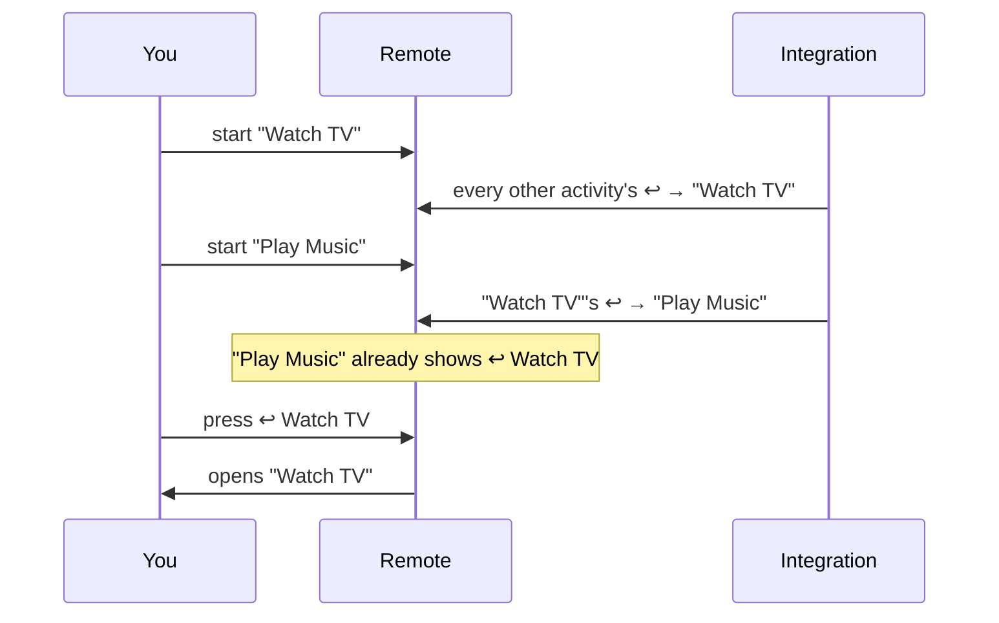

Why it works this way: the remote only switches screens when *you* press a button that starts an activity. An integration can't switch screens, so instead it rewrites the ↩ buttons ahead of time. While you're in one activity, the ↩ buttons in all the others already point to it.

The integration follows the remote's own events, so it also sees you reopen an activity that is still on (for example with ↩), and the ↩ buttons keep pointing the right way.

### 7. Display brightness on the touch slider

1. Integrations → Remote Self-Control → add **Display Brightness** (and/or **Button Backlight**).
2. In an activity's user-interface settings, set the **touch slider** to **Display Brightness**.
3. Slide to set the screen brightness. It turns display auto brightness off; *off* means the dimmest level.

### 8. A power icon that turns green when the receiver is on

State icons make a button on a page follow a device's state. The button's own icon or text is the **default** look; you drop in an image (and/or type a label) for each state.

1. Put a button on the page of a **single-page** activity, for example a gray power icon or a text button "Receiver". This is what it shows when the receiver is off.
2. Open the builder and switch to the **Icons & Sliders** tab → **+ Create state icon**, and give it a name.
3. **The button:** pick the activity, then click the button in the drawing of its page.
4. **What it shows:** pick the device (your receiver) and what to check (*state*). The builder shows its value right now.
5. **Looks:** for *ON*, drag in a green power image (any PNG, JPG or SVG; it's resized to 90×90 and uploaded to the remote) and optionally a label like "Receiver ON". Add more states if you like (*STANDBY*, an input name, …).
6. **Save.** Within about 2 seconds of the receiver turning on, the button shows the green icon; when it turns off it goes back to its default. What the button does when pressed doesn't change.

<p align="center"></p>

Setting it up in the builder:


**Caveats**

- **Single-page activities only.** On the remote, changing a page of the activity you're looking at sends you back to that activity's first page when it has more than one page. So the builder only lets you pick activities with exactly one page; activities with more pages are listed but greyed out.
- **If you add a second page later**, the state icon stops updating (it's never forced on a multi-page activity) and the builder shows a warning on it. Remove the extra page, or remove the state icon.
- **Only icon and text buttons** can change. Media player widgets, sensor tiles and lists can't be used.
- **About 2 seconds' delay**: the integration checks the device every 2 seconds while the remote is awake. While the remote sleeps nothing is checked; the button catches up within a couple of seconds after it wakes.
- **The default look is captured when you save.** If you later change that button's icon or text in the web configurator, delete the state icon and add it again so it learns the new look. Don't move the button to another spot; the integration finds it by its position.
- **Uploaded images stay on the remote** as custom icons (named `si_…`) after you delete a state icon. Delete them in the web configurator if you don't need them.

### 9. A receiver volume slider

A slider is a light entity of this integration that stands for a number on another device. Its brightness (0–100 %) maps to the range you choose, so the remote's own slider pop-up and the Remote 3 touch slider work with it.

1. In the builder, open the **Icons & Sliders** tab → **+ Create slider**, and give it a name.
2. **Device:** pick your receiver. The builder fills in the rest for you: it reads the **volume**, sends it with the **volume** command, range 0–100. Lower **Highest** if you never want it louder (e.g. 60).
   - For a device without a "set volume" command (IR, or only volume up/down), choose **Press up / down commands**: pick the up and down commands, how much one press changes it, and the pause between presses. Without anything to read it from, the slider remembers the last value it set.
3. **Save**, then type a value under **Try a value** and press **Set** to check it.
4. Integrations → Remote Self-Control → add the new slider (group **Remote Sliders & Menus**).
5. Put it on a **home page**: tapping the tile opens the slider pop-up. On a Remote 3 you can also set an activity's **touch slider** to it.
6. Optional: pick a **tile icon** (step 4), and in step 5 pick a single-page activity and click the button that should **show the level**, then pick a design and color (below).

The slider follows changes made elsewhere (within about 2 seconds while the remote is awake). Switching the slider **off** sets the lowest value; **on** goes back to the last value. When you drag quickly, the newest position wins: values in between are skipped instead of queued.

**Custom graphics.** The slider pop-up itself is drawn by the remote and can't be restyled, but two things can:

- **Tile icon:** 12 icons (volume, speaker, subwoofer, light bulb, brightness, blinds, temperature, fan, knob, equalizer, microphone, list) for the slider's or menu's tile on home pages and in lists. Pick one on the card; it's uploaded to the remote and set once the entity has been added to the integration.
- **Level picture:** a button on an activity page whose picture shows the current value. 16 designs: bar, column, arc gauge, ring, dots, signal, speaker, knob, tank, thermometer, equalizer, segments, battery, needle, pie and steps. Pick the color on a **color wheel**, and add **Change color from a value…** steps (for example orange from 60 %, red from 85 %). 11 pictures (0 %, 10 % … 100 %) are made in the builder and uploaded when you save, and the button shows the one closest to the value. **Size** (full, large, medium) leaves room around it. Same limits as state icons: **single-page activities only**, about 2 seconds' delay. What the button does when pressed doesn't change (map it to the slider's toggle or volume up, for example).
- **Only when the value changes:** **Show the level** → *Only for a few seconds when the value changes* (1–60 s, default 4). The button shows its own look until the value changes (from anywhere, e.g. the remote's volume keys), then the level appears and hides again after the set time.


### 10. A pop-up menu for the receiver's inputs

A quick menu is a list entity whose choices each run steps, the same steps as a Smart Control.

1. In the **Smart Controls** tab, open **or a quick menu from a device's list…** and pick *Receiver: Select source*. You get one choice per input, each switching the receiver to it and marked as current while the receiver is on that input.
2. Rename the menu and the choices ("TV", "Shield", …), remove the ones you don't use, and add steps if you like (turn the receiver on first, set the volume, change the backlight color, …).
3. **Save**, then press **Run** on a choice to try it.
4. Add the menu to the integration, and put it on a home page or an activity page: it opens the remote's list pop-up; picking a choice runs it.

**Step through on a button:** map a physical button to the menu's **Select next** (or **Select previous**) in the activity's button mapping. Each press runs the next choice; with *start over at the first* ticked (the default), it goes back to choice 1 after the last.

Choices without a *current when* condition show as current after you pick them. **+ Create quick menu** starts an empty menu for anything else, for example scenes that set lights, inputs and volume together.


### 11. The volume keys and touch slider for a light (Controls)

Point the remote's volume rocker and touch slider at something else for a moment (a light, a tone control, the screen), and get the remote's own volume pop-up with it.

1. Builder → **Controls ⇅** tab → **+ Create control**, name it (*Ceiling Light*) and pick what it changes: a light, a volume, the remote's display or backlight brightness, or one of your sliders (for IR up/down devices).
2. Set the **starting value** and the **change per rocker press**. For devices that don't report their level, choose whether it starts from the value it was left at or from the starting value every time; **Reset the value** fixes the count when it gets out of step.
3. **Settings:** how long a control stays on after the last press (or until changed), and per activity what the rocker and touch slider do when no control is on (your TV's volume, the screen brightness, or nothing). **Borrow** keeps the rocker mapped straight to your TV and points it at *Control* only while a control is on.
4. Integrations → Remote Self-Control → add **Control**, **Control Level**, **Control Active** and the new **Control: Ceiling Light** switch (group **Remote Controls**). Put the switch on a page, set the touch slider to *Control* (or *Control Level*).
5. Press **Control: Ceiling Light**: the rocker now changes the light with the vertical pop-up, the slider too, and after the timeout everything goes back. Turning another control on switches to it.

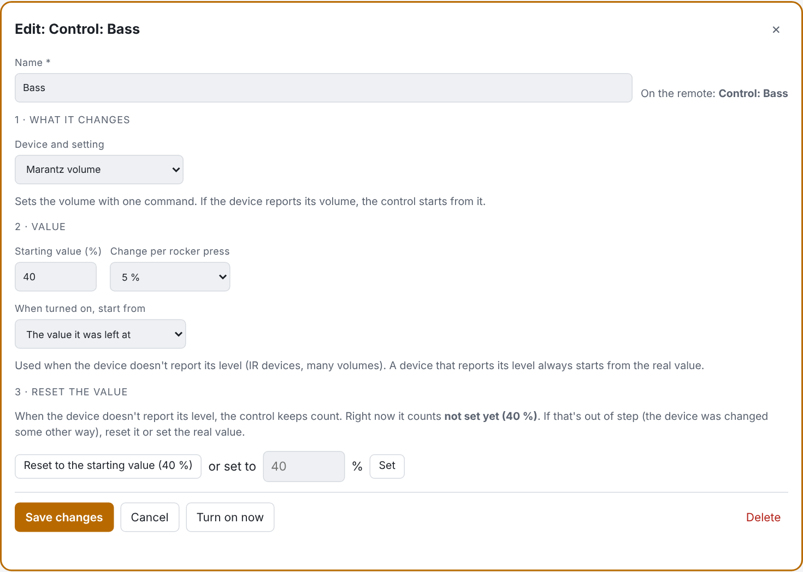

### 12. Back up everything

Builder → **Backup** (top right) → **Download backup** saves one `.json` file with your smart controls, sliders and quick menus, state icons and level pictures, ↩ buttons and Controls, **plus the custom pictures** they use. It doesn't contain the integration's login to the remote.

**Without the builder** (or with [Integration Manager](https://github.com/JackJPowell/uc-intg-manager)'s **Backup Config**): web configurator → Integrations → Remote Self-Control → Reconfigure → **Back up settings** shows the same settings as text to copy (the pictures stay on the remote and aren't in the text). **Restore settings from a backup** takes that text, or the builder's backup file's contents, and puts everything back.

To restore, choose the file, tick the parts you want and press **Restore**. Every part is checked first; if one has a problem nothing is changed. Missing pictures are uploaded again, so it also works after a factory reset or on another remote (↩ buttons for activities that don't exist there are skipped).

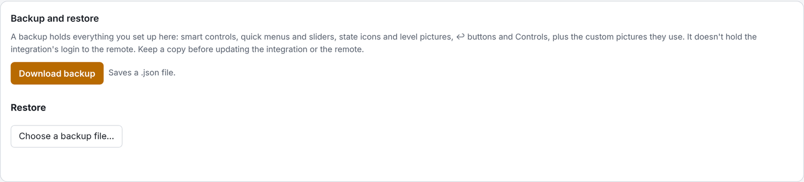

### 13. Jump to a page, and start pages

The remote has no "go to page" command, but it always opens an activity on its first page and jumps to the first page when the page order of the activity on screen changes. The integration uses that: it turns the page order around (your swipe order stays the same, it just starts at another page), and puts your own order back when you leave the activity.

- **Go to page** (a step in smart controls and quick menus): pick *The activity on screen* and a page (*Page 2*, or a page by name), or a specific activity and one of its pages. With branches you get page jumps with logic: "if the Shield is playing → the Apps page, otherwise → the Remote page". If the chosen activity isn't on screen, it opens on that page next time.
- A smart control with a Go to page step can sit in several activities: in one that doesn't have that page, the jump is skipped (the Last Result says so) and the other steps still run. *Page 2* means the 2nd page of whichever activity is on screen.
- **Start pages** (Return & Pages tab, with the Device states panel beside it): per activity, *if* conditions → *open on* a page, *otherwise* another page or its own first page. They're checked every few seconds while the activity isn't on screen, so it opens on the right page.

A jump takes about a second. Like state icons, pages are only changed when you ask for a jump or after you've left the activity.

### 14. One button for whichever activity fits (smart launchers)

*Beta. It creates activities on your remote: back up in the web configurator first.*

A launcher is one button that opens the activity your conditions pick: *if the Shield is on → Watch ShieldTV, otherwise → Watch RokuTV*. It can also run extra steps after that activity starts (optional).

1. Builder → **Smart Launchers** → **+ Add a launcher**, give it a name (optionally drop a picture).
2. Activity 1: *Watch RokuTV*. **Add another activity**: *Watch ShieldTV*. Optionally **Add extra steps after it starts** for either, with a wait before them.
3. **Add a condition branch**: *SHIELD state is ON* → open *Watch ShieldTV*. *Otherwise open*: *Watch RokuTV*.
4. **Save launchers**, then **Add a button**: on an activity page, a physical button or the home screen.

Why it works this way: the remote only switches to an activity's screen when the button you press starts that activity directly (a macro or an integration can start it, but the screen stays where it is). So the launcher decides *before* the press. For each of its activities the integration keeps a **launcher copy** (same devices, pages and buttons, named after the launcher, with the extra steps at the end of its start sequence), and points the launcher's buttons at the copy your conditions pick. The press is then a plain "start activity".

- **Already on or all off:** the remote handles that as for any activity: it skips the power-on steps of devices that are already on and runs the rest of the start sequence and the extra steps.
- Edit the **original** activities, not the copies: the copies follow within about a minute. ↩, start pages, state icons and Controls treat a copy as its original; the copies are put in the same activity groups, so going from Watch RokuTV to its launcher copy doesn't turn devices off and on.
- Buttons you make in the web configurator that start one of the copies are found and kept pointed right too (**Look for launcher buttons again**).
- A button on a page of the activity on screen is re-pointed when you leave it (changing a page you're looking at would jump to page 1). Physical buttons and home tiles change at once.
- **Remove everything** and removing a launcher point its buttons back at the original activity and delete the copies. Launchers are part of the backup.

### 15. Edit your activities on a picture of your remote (Page Editor)

1. Builder → **Page Editor** (the first tab) → **Activities ▾ → Interface**, and pick the activity and page at the top.
2. In **Pictures**, choose where the pictures come from, then drag one onto the remote's screen (or click it, then a spot). Drag widgets from the right.
3. Click the new button, then **What it does** → pick the device and its command. If that device isn't in the activity's start and off sequences yet, the **guided setup** opens: answer its few questions and its steps are added in the right order.
4. Click a physical key or the touch slider on the drawing to set them too.
5. **Save to remote**. If that activity is on the remote's screen right now, its pages are saved once you leave it.

See [Page Editor](#page-editor) for everything else it does.

## The builder

The integration serves its own builder page on your network, at `http://<remote-name>.local:10123/` or `http://<remote-ip>:10123/`. The exact addresses are shown in Integrations → Remote Self-Control → Configure.


- **Log in** with the web-configurator PIN.
- **Pick, don't type:** the builder lists your remote's own devices with their commands, inputs and sound modes, your activities, and the remote's own controls and settings.
- **If / Else if / Otherwise** branches, each with conditions and steps. The first matching branch runs.
- **Templates** for the remote itself (Night Mode, Quiet Mode, color cycle, brighter/dimmer, backlight by time) and for your devices (smart volume, play/pause or turn on, input with wait, sound mode cycle, action per activity).
- **Create, then list:** each tab starts with its **+ Create** button. It opens an editor box for the new item; a **name is required**. After **Save**, the item shows below as one bar with its name, what it does and an **Edit** button that opens its settings again (with **Delete** inside).
- **Save** writes to the remote (everything is checked first; errors are listed in the editor). **Save & test** runs a smart control once and shows the result.
- **Device states (live)** (Smart Controls and Icons & Sliders tabs): pick a device and see every value its integration reports, updated every 2 seconds, with all values seen so far. Tick *Keep collecting in the background* to gather values that only show up now and then (an audio format, an app name). It sits to the right of the editor. Click a value field in the editor, then a value in the panel to fill it in (a condition also gets that device and attribute); in a state icon a clicked value is added as a state, and *use* points a slider at a number. Values seen are also offered in the value lists of state icons and conditions.
- **Backup** (top right) saves and restores everything you set up, with its pictures (walkthrough 12). **Rules text** exports and imports the smart controls alone as JSON, for sharing.
- **Theme** (top right): Automatic (follows your system), Desktop, Dark mode, Remote style, Midnight blue or High contrast, for every tab including the Page Editor.
- Works on phones and in dark mode, and needs no internet: everything is served by the remote.

| Dark mode | Phone |
|---|---|
|  |  |

After saving, add new controls to the integration (Integrations → Remote Self-Control → add entities) and to the activities that use them. Smart Controls run in the background, so they can't switch the remote's screen to another activity (use the ↩ button for that).

Without a browser, the same JSON can be pasted in the integration's setup screen (*Edit Smart Controls (text)*).

### Examples

- `examples/remote-only-rules.json`: Night Mode, Quiet Mode, color cycle, brighter/dimmer. Works on any remote.
- `examples/shield-tv-receiver-rules.json`: device rules for an NVIDIA Shield, a Samsung TV and a Marantz receiver (smart volume, play/pause, input with wait, sound mode cycle). Replace the `YOUR_…_ID` placeholders in `aliases` with your own entity ids, or rebuild them from the builder's templates.

## Entities

Grouped by area in the web configurator.

| Group | Entity | Type | What it controls |
|---|---|---|---|
| **Remote Display** | Display Brightness Level | select | 10 % … 100 % (turns display auto brightness off) |
| | Display Brightness | light | brightness for the **touch slider**; off = dimmest |
| | Display Timeout | select | 5 s … 60 s |
| | Display Auto Brightness | switch | display follows the light sensor |
| **Remote Buttons** | Button Backlight Level | select | Off, 10 % … 100 % |
| | Button Backlight Color | select | 12 presets (Warm white … Cool white) |
| | Button Backlight | light | on/off, brightness, color |
| | Button Backlight Auto | switch | backlight turns on by itself in a dark room |
| **Remote Settings** | Sound Effects Volume | select | 0 % … 100 % |
| | Wake Sensitivity | select | Off, Low, Medium, High |
| | Sleep Timeout | select | 1 min … 3 h, Never |
| | Wake on LAN | switch | Wi-Fi wake |
| | Sound Effects | switch | on/off |
| | Haptic Feedback | switch | on/off |
| **Remote Navigation** | Previous Activity | sensor | name of the activity used before the current one |
| **Remote Controls** | Control | media player | volume rocker / touch slider target; its volume is the level being changed |
| | Control Level | light | the same level as a light (touch slider set to a light, home tile pop-up) |
| | Control Active | sensor | "Ceiling Light · 60 %" or "None" |
| | Control: (your control) | switch | turns that control on (and any other off) |
| *(builder)* | State icons | page buttons | icon/label follows a device's state (single-page activities) |
| **Remote Sliders & Menus** | (your sliders) | light | slider pop-up / touch slider for a number on a device |
| | (your quick menus) | select | list pop-up; each choice runs steps |
| **Remote Smart Controls** | (your Smart Controls) | button | press to run |
| | Smart Controls: Last Result | sensor | what the last Smart Control did, or its error |

Tips:

- In macros, activities and UI buttons, prefer the **select** entities ("Select option"). The remote's editor passes the light's "brightness %" and "color" commands through unconverted, so they are unreliable there.
- A UI button's entity must also be in that activity's devices, otherwise the web configurator says "Invalid request. Check your input."
- The web configurator doesn't list **sensor** entities when you edit an activity. Use *Configure → Add the Last Result tile to an activity* for the Last Result tile; the ↩ button already shows the previous activity's name.

## Rules reference

```json
{
  "aliases": { "receiver": "uc_denon_driver.main.media_player.YOUR_RECEIVER_ID" },
  "buttons": [
    {
      "id": "smart_volume_up",
      "name": "Smart Volume Up",
      "cases": [
        { "if": { "entity": "receiver", "is": "ON" },
          "do": [ { "cmd": "media_player.volume_up", "entity": "receiver" } ] },
        { "else": [ { "cmd": "media_player.volume_up", "entity": "samsungtv_driver.main.media_player.YOUR_TV_ID" } ] }
      ]
    }
  ]
}
```

| Condition | Example |
|---|---|
| Device | `{ "entity": "tv", "attr": "source", "is": "HDMI2" }` (`is`, `is_not`, `in`, `not_in`, `>`, `<`, `>=`, `<=`, `contains`) |
| Activity | `{ "activity_on": "<activity id>" }` |
| Time | `{ "time_between": ["22:00", "06:00"] }` |
| This remote's control | `{ "control": "backlight_color", "is": "Movie red" }` |
| This remote's setting | `{ "setting": "display.brightness", ">": 50 }`, `{ "setting": "battery.level", "<": 20 }`, `{ "setting": "battery.charging", "is": true }` |
| Memory | `{ "var": "night_mode", "is": "on" }` |
| Combine | `{ "all": [ … ] }`, `{ "any": [ … ] }`, `{ "not": … }` |

| Step | Example |
|---|---|
| Device command | `{ "cmd": "media_player.select_source", "entity": "receiver", "params": { "source": "SHIELD" } }` |
| IR / simple command | `{ "cmd": "DIMMER", "entity": "receiver" }` |
| This remote's control | `{ "self": "display_level", "option": "up" }`, `{ "self": "haptic", "state": "toggle" }` |
| Wait | `{ "delay": 500 }` |
| Wait until | `{ "wait_until": { "entity": "receiver", "is": "ON" }, "timeout": 10000 }` |
| Memory | `{ "set_var": "night_mode", "to": "on" }` |
| Remember / restore settings | `{ "save_settings": "before" }`, `{ "restore_settings": "before" }` |
| Go to page | `{ "page": "Apps" }` (activity on screen; a name, page id or `"#2"`), `{ "page": "Apps", "activity": "<activity id>" }` |
| Stop | `{ "stop": true }` |

For lists, `option` can also be `next` / `previous` (wraps around) or `up` / `down` (stops at the ends). The short form `{ "id", "name", "if", "do", "else" }` works too. Limits: 60 smart controls, 12 branches each, 24 steps per branch, pauses and waits up to 60 s; 60 state icons watching up to 25 devices; 30 sliders, quick menus (30 choices each) and Controls. A press while the same control is still running is ignored.

## Security

- The builder requires the web-configurator PIN. The PIN is checked against the remote and never stored. A session lasts 12 hours (HttpOnly, SameSite=Strict cookie).
- After 5 wrong PINs from one address, logins are blocked for 5 minutes.
- The builder is plain HTTP on your local network, like the web configurator itself. Don't forward port 10123 to the internet.
- The **Page Editor** reaches the remote's API through the builder (same login). It only lets through what the editor needs: activities, activity groups, macros, the home screen, pictures, entities and integrations. API keys, system commands (reboot, update, power), the remote's settings and deleting whole collections are refused. Its remote backups stay on the remote (newest two).
- The integration holds an admin API key for the remote. Removing the integration does not revoke it: list keys with `GET /api/auth/api_keys` and delete with `DELETE /api/auth/api_keys/{id}`.

## Configuration

| Environment variable | Default | Purpose |
|---|---|---|
| `UC_SELF_BUILDER_PORT` | `10123` | Port of the builder page |
| `UC_SELF_RETURN_POLL_MS` | `2000` | How often activity states (↩ button), state-icon devices, slider values and menu conditions are read |
| `UC_SELF_SLIDER_HOLD_MS` | `3000` | After you move a slider, device reports are ignored this long so a slow device can't jump it back |

Files in the integration's config folder: `self_control.json` (address + API key), `smart_rules.json` (your rules; absent = defaults), `smart_vars.json` (remembered values), `return.json` (↩ settings and activity history), `state_icons.json` (state icons and each button's default look), `sliders_menus.json` (sliders, quick menus and their last values), `controls.json` (Controls), `states_seen.json` (values seen in the device states panel). The Page Editor adds `app_links.json` (Android TV app links) and keeps its remote backups on the remote (the newest two). The builder's **Backup** saves all of these except the login and the caches.

## Logs and removal

- Logs: web configurator → Settings → Development → Logs (lines start with `[self-control]`).
- Remove: in the builder, **Backup** → download a backup, then **Remove everything** (tick both options to also delete its pictures and its API key). Then delete the integration instance and the driver. The *Smart Controls* page with the Last Result tile (if you added it) stays until you delete it.

## Development

```
src/driver.json                         metadata and first setup screen
src/bin/driver.js                       entities, commands, setup flow, polling
src/bin/core.js                         REST client for the remote's Core API
src/bin/smart.js                        Smart Controls: validation and engine
src/bin/web.js                          builder web server and device catalog
src/bin/web/builder.html                builder page (no external files; works offline)
src/bin/web/editor.html                 Page Editor (shown in the builder's first tab)
src/bin/editor.js                       Page Editor: Core API pass-through (allow list), pictures, remote backups
src/bin/tile.js                         puts the Last Result tile on an activity page
src/bin/returnbtn.js                    return to previous activity (tracking + ↩ buttons)
src/bin/stateicons.js                   state icons (watch devices, switch button looks)
src/bin/extras.js                       virtual sliders and quick menus
src/bin/controls.js                     Controls (volume rocker / touch slider for other things)
src/bin/states.js                       device states panel (live values, values seen)
src/bin/coreevents.js                   the remote's own events (which activity was opened)
src/bin/backup.js                       backup and restore
src/bin/pages.js                        page jumps and start pages
src/bin/default-rules.json              default Smart Controls (Smart Test Button)
examples/                               example rules
test/                                   fake Core API + Integration-API test client
```

Tests (Node 22):

```
npm install                 # dev dependency: ws
(cd src/bin && npm install)
npm test                    # builder page, settings, Smart Controls, return, state icons, sliders & menus, Controls, device states, events, launchers, Page Editor
```

Build the install archive:

```
./build.sh                  # -> dist/uc-intg-self-control-<version>.tar.gz
```

Built on the [Integration API](https://github.com/unfoldedcircle/integration-node-library) and the [Core REST API](https://github.com/unfoldedcircle/core-api) by Unfolded Circle.

## Changes

- **1.2.4:** smart controls and quick menus can move your sliders: step **This remote's control → Your sliders → Slider: <name>** with *up one step*, *down one step*, *up / down 5 steps* or *set to* a value (the slider then sends the device's own commands, e.g. volume up presses). Sliders can also be checked in conditions. Map two smart controls to the volume keys for "Samsung volume up / down".
- **1.2.3:** everything this integration made (sliders, quick menus, smart controls, switches…) is listed together, sorted by kind, in its own group **Remote Self-Control (made here)**: in the device states (live) panel right after "This remote", and in the device pickers (smart controls, state icons).
- **1.2.2:** sliders that press up / down on a device that doesn't report its value: they start at the bottom, and setting the bottom presses down the whole range (and a little more), so the device really is at its lowest and the guess starts from zero again. Every move up counts from there. Can be turned off per slider.
- **1.2.1:** Smart Controls: the integration's own entities (sliders, quick menus, other smart controls, switches) can be used in steps, conditions and "wait until", listed in their own group **Remote Self-Control (made here)**. They show once they're added to the remote.
- **1.2.0:** slider **level pictures** reworked: an orange frame on the page sets the area (drag to move, drag the edges or corner to resize, e.g. 2 × 4; empty spots get a blank button), a new **Text** design ("62 %" as big as the whole area) plus Block, Thin bar, LED meter, Dial and Slider (22 designs), colours as one colour, changes at values or a **smooth blend**, a **gradient inside the picture**, an optional text label in a chosen button (62 % / 62 / the device's value), and more times to show it (only while changing, 2 s … 5 minutes, with or without restarting the time on each change).
- **1.1.0:** new **Statistics** tab: which activities you use, for how long and when (weekday × hour), screen-on time, battery used per activity while off the dock (marked reliable once there's enough data), idle drain, the battery level over the last 7 days and how long a charge lasts at your usual use. Collected by the integration on the remote while it runs (about every 20 s; a battery reading every 5 / 15 / 30 minutes, kept 30 / 90 / 365 days), with CSV download and Clear. The Page Editor is no longer marked beta.
- **1.0.10:** Page Editor **Home screen** rearranged: Pictures window | home screen groups | activities and devices. Tiles show their picture; drag a picture onto a tile (or click a picture, then the tile) to give that activity, macro or device its icon, saved with **Save home screen**. Fix: the built-in icons were missing from the Pictures window on the other tabs.
- **1.0.9:** the Pictures window on the other tabs looks like the Page Editor's: the same tiles, as many across as the page open in the Page Editor, and as wide as its window (it follows the Page Editor when that changes).
- **1.0.8:** one look for the whole builder, after the Page Editor: the same one-row header on every tab, a section bar per tab (e.g. State icons / Sliders, ↩ buttons / Start pages) with its status, and ⓘ for what the tab is for. The Page Editor's **Pictures window** now sits beside every editor that takes a picture (state icons, sliders and quick menus, ↩ buttons, Smart Launchers): click a picture box, then a picture (icons on the remote, the remote's built-in icons, level pictures & state icons, the drawn tile icons, or from your computer), or drag one onto the box. A ↩ button gets its own copy of the picture. Fixes: Page Editor built-in icons no longer turn into names after saving; Return & Pages shows the activities now / before by name.
- **1.0.7:** Page Editor: no more full remote backup before the first change. The remote stops every integration while it makes one, this one included, so it failed ("backup failed") and disconnected your devices meanwhile. Instead the integration keeps a copy of your activities (pages, keys, sequences), activity groups, macros and home screen: **Last copy before changes**. Keep making full backups in the web configurator.
- **1.0.6:** Page Editor, **Level pictures & state icons**: pictures nothing uses any more can be deleted (Select… → Delete). Ones still used by a level picture, state icon or ↩ button in the builder, or shown on a page, are kept and marked, so a level picture never loses a frame.
- **1.0.5:** Page Editor: a fifth picture list, **Level pictures & state icons**, shows the pictures this integration made (the 11 frames of each level picture, state-icon and ↩ pictures). Drag them onto the screen like any picture.
- **1.0.4:** Page Editor: a sensor, select or media widget whose device isn't on the remote any more (e.g. removed from Home Assistant) is outlined in red, and left out when its page is saved, with a note saying which one. The remote refuses to save a page that still has one ("Invalid sensor configuration").
- **1.0.3:** the 10 % screen limit from 1.0.1 is removed again (Display Brightness "off" is the dimmest level). Page Editor: built-in icons are drawn at the size of their tile in the Pictures window.
- **1.0.2:** Page Editor: the Pictures window is as tall as the remote and its pictures scroll inside it; the pictures are bigger and fill the window, with as many per row as the page has columns. App links: `market://launch?id=` links no longer open apps since a Google Play Store change; use the app's own deep link in the text file instead (see App links).
- **1.0.1:** Page Editor: an activity only counts as on the remote's screen while it is on and the remote's screen is on (asleep, docked or with every activity off, pages are saved right away; "On screen now" says so). The screen is never set below 10 % by the integration: Display Brightness "off" / toggle, its touch slider and Controls stop at 10 % instead of an unreadable 1 %.
- **1.0.0:** first 1.0 release, with everything from 0.9.0–0.9.10: the **Page Editor** (activities, pages, pictures including the remote's built-in icons, widgets, keys, start and off sequences with a guided setup, activity groups, home screen, macros, devices and integrations, Android TV app links), the theme picker, and backups with [Integration Manager](https://github.com/JackJPowell/uc-intg-manager) (from 0.8.8). New README with pictures of every part.
<details><summary>Earlier versions</summary>

- **0.9.10:** Page Editor: the Pictures window shows as many pictures per row as the page has columns, and sits beside the remote's screen (the activity and page bar runs across the top), for easy drag and drop.
- **0.9.9:** Page Editor: the remote is drawn bigger (up to 1.7× the window height; the page scrolls, and the remote stays in view only when it fits); the side windows are a little narrower; pictures in the Pictures window are the same size as on the remote's buttons.
- **0.9.8:** includes 0.8.8's backups with [Integration Manager](https://github.com/JackJPowell/uc-intg-manager): its **Backup Config** saves your settings (now with the Page Editor's app links) as text, and **Reconfigure → Restore settings from a backup** puts them back. Both choices are also in the integration's own setup.
- **0.9.7:** Page Editor app links: an app the device already has in its own source list isn't added a second time (names compared loosely, e.g. YouTube / You Tube); the import says which were skipped. Buttons already on the remote that use a link from the list show "select source · <name>" right after the import, and a custom value that's in the list shows the app name.
- **0.9.6:** Page Editor: the remote is drawn as big as the window allows and stays in view while the page scrolls; the pictures and settings columns take their full height (the page scrolls, not those windows). The Remote 3 / Remote Two choice only shows when the model couldn't be read from the remote. The builder's header is one row on the Page Editor tab.
- **0.9.5:** Page Editor: built-in icons are drawn as icons. The integration reads the font, the character for each icon and the web configurator's name aliases from the remote's own web configurator (Font Awesome 6 Pro, light), and sends the browser only the remote's own icons.
- **0.9.4:** Page Editor: the whole remote is always in view (drawn smaller to fit the window), and the Pictures and settings columns are as tall as the remote, each scrolling inside. Inside the builder the editor fills the window, with one compact top bar.
- **0.9.3 (beta):** Page Editor:
  - new widgets start at 1 × 1 (media widget 4 × 2);
  - **Custom value** for commands such as select source (e.g. an Android TV app link);
  - **App links** for Android TV integrations, loaded from a text file (`<command> = <name>`) and shown by name everywhere;
  - the top bar stays in place while scrolling;
  - one **Pictures** window with a selector, including the remote's **built-in icons**;
  - **Not added yet** in What it does, to add devices your integrations offer straight from a button;
  - **Smart** lists every Remote Self-Control entity, also the ones not added yet;
  - Integration Manager isn't listed; **+ Add an integration** opens it, or the web configurator's Integrations page.

  Faster: the builder and editor pages and larger answers are sent compressed (about a quarter of the size), and the editor reads everything from the remote in parallel. App links are part of the Backup.
- **0.9.2:** Page Editor: **What it does** opens on a list of devices (this activity's first, then the rest) instead of the first 80 commands; click a device for all its commands, or type to search everything. It opens on the device of the button's current command.
- **0.9.1:** Page Editor, Devices & integrations: every device an integration offers has its own **Add** button (added at once, no save needed), or tick several and **Add the N ticked**; the integration list shows how many devices each one offers; messages show at the top of the page; devices the remote lists with their full id are added correctly.
- **0.9.0 (beta):** **Page Editor** (new first tab): activities on a picture of your Remote 3 / Remote Two with pages, pictures (Icons, Channel icons, Local folder), widgets, physical keys and touch slider; start and off sequences with a **guided setup** for new devices (display, receiver, streaming, amp, Home Assistant, other) that adds their steps in signal-flow order with recommended waits; activity settings; activity groups; macros; home screen with backgrounds; devices & integrations. Full remote backup before the first change (newest two kept on the remote). **Theme picker** for the whole builder: Automatic, Desktop, Dark mode, Remote style, Midnight blue, High contrast.

- **0.8.7:** smart launchers: extra steps after the activity starts are optional and no longer described as "the app".
- **0.8.6:** the builder tab is called **Smart Launchers**.
- **0.8.5 (beta):** **Smart Launchers** (new tab): one button (page, physical or home screen) that opens the activity your conditions pick, optionally with extra steps, using launcher copies of your activities that follow their original. ↩, start pages, state icons and Controls treat a copy as its original. Part of the backup and of Remove everything.
- **0.8.4:** the Device states (live) panel is also in the Return & Pages tab, for start-page conditions (click a value field, then a value). A Go to page step whose page doesn't exist in the activity on screen is skipped (noted in the Last Result) instead of stopping the smart control.
- **0.8.3:** safety: state icons and level pictures write each activity's page at most every 5 seconds; if a page was changed outside the integration (e.g. in the web configurator) its state icons pause instead of overwriting it (save them again to resume); a counter shows how many changes the integration made to the remote in the last hour; **Remove everything** (Backup panel) puts back what the integration changed before you uninstall it (state icons, ↩ buttons, page orders, borrowed volume keys, quick-menu buttons, optionally its pictures and its API key).
- **0.8.2:** fix: when the integration changed an activity's pages (a start page, a ↩ button), the remote's report of that change was taken as you opening that activity, so ↩ could lead to the wrong activity (e.g. the page-jump test activity). Those reports are now ignored.
- **0.8.1:** **Page jumps**: a *Go to page* step for smart controls and quick menus (the activity on screen, or the page another activity opens on), and **start pages** per activity with if / otherwise (Return & Pages tab). Pages are rotated so your swipe order stays, and your own order comes back when you leave. Start pages are part of the backup.
- **0.8.0:** Backup and restore in the builder (Backup button): one .json file with smart controls, sliders and quick menus, state icons and level pictures, ↩ buttons and Controls, plus the custom pictures they use (not the login). Restore picks the parts, checks them all before changing anything and uploads missing pictures. The Return tab's event test panel is removed (the events are used automatically).
- **0.7.9:** Return: the integration listens to the remote's own events, so going back with ↩ to an activity that is still on is seen: the ↩ buttons follow it and "turn off when leaving" works there too. Previous Activity sensor shows the name and is only sent when it changes.
- **0.7.8:** fix: editing a smart button, slider or quick menu that is already on an activity no longer breaks it (saved ids stay fixed; the remote gets the new definition right away; removed ones show as unavailable). Quick menus: the step-through button option is gone (map Select next/previous). Return: "turn off when leaving" sends a plain activity.off (no activity groups) + a test panel of the remote's own events. Slider levels: one button, no draw-over, 16 designs (Battery, Needle, Pie, Steps added), color wheel, colors by value. Controls: start from the last or the starting value; reset / set the counted value.
- **0.7.7:** higher limits: 60 smart buttons (12 cases, 24 steps, pauses and waits up to 60 s), 60 state icons watching up to 25 devices (24 states each), 30 Controls, 30 sliders, 30 quick menus with 30 choices, 30 watched devices, 512 KB builder saves. The State icons tab shows how many icons and devices are in use and how long the last check took on the remote.
- **0.7.6:** battery: *This remote* in the device states panel shows battery level, charging, on the charger and status; all four can be used in smart-control conditions (e.g. battery level < 20).
- **0.7.5:** device states panel: *This remote* entry (screen and backlight brightness, sound, haptic, timeouts and this integration's controls such as backlight color), devices grouped by integration (Home Assistant, Denon, …), clicking a remote value sets a setting or control condition; more settings available in conditions.
- **0.7.4:** fixes the builder page not loading in 0.7.3 (a quote in a help text broke its script); a test now checks the page script.
- **0.7.3:** device states panel moved to the right of the editor; clicking a value fills the value field you clicked last (conditions also get the device and attribute), and copying works on the builder's plain-http address.
- **0.7.2:** **Device states (live)** panel in the builder (live values, values seen, background collecting, click to use).
- **0.7.1:** turn off when leaving: activity group members are read per group (the remote's group list has no members), so members you added yourself are kept.
- **0.7.0:** **Controls**: a *Control* media player for the volume rocker and touch slider, *Control: <name>* switches that point them at a light, a volume, the remote's own brightness or a slider, a *Control Active* sensor, per-activity defaults (or nothing), a borrowed volume rocker (mapped to Control only while a control is on) and a timeout or stay-on-until-changed. New *Controls ⇅* tab in the builder.
- **0.6.0:** **New builder layout**: a *+ Create* button per tab opens an editor box (name required); saved items are listed as bars with what they do and an *Edit* button. Three tabs: *Smart Controls* (smart controls and quick menus), *Icons & Sliders* (state icons and sliders) and *Return ↩* (per-activity ↩ buttons with custom pictures and turning off the activity you leave). ↩ buttons no longer add a row to a full page (that resized every button and broke picture-tile pages); new option to use the physical button only where the on-screen button doesn't fit. **Sliders & quick menus**. 12 tile icons for sliders and menus, and **level graphics** (12 designs × 6 colors, on one button or stretched over several, e.g. a column down the left side, always shown or only for a few seconds after the value changes) as a new kind of state icon that shows a number as a bar, gauge, dots and more. Sliders are light entities mapped to a number on any device (one "set value" command, or repeated up/down presses), with the remote's slider pop-up on home tiles and the Remote 3 touch slider; they follow the device's value. Quick menus are select entities whose choices run Smart Control steps, with an optional condition that marks the current choice; *Add from a device's list* builds one from a device's inputs or sound modes.
- **0.5.0:** **State icons**: new *State Icons* tab in the builder. Pick a button on a single-page activity, a device and what to check, then drop an image and/or type a label per state; the button switches look within about 2 seconds and returns to its own look otherwise. Images are resized to 90×90 and uploaded to the remote. Builder renamed *Remote Self-Control Builder* with *Smart Controls* and *State Icons* tabs.
- **0.4.0:** Return to previous activity: tracks the activities you start and keeps a ↩ text or icon button and/or a physical button pointed at the previous one, set up in the integration's Configure menu. New Previous Activity sensor (area Remote Navigation). Smart Control results name devices instead of showing entity ids.
- **0.3.2:** new **Display Brightness** light entity so the Remote 3 touch slider can set the display brightness.
- **0.3.1:** setup option "Add the Last Result tile to an activity".
- **0.3.0:** Smart Controls are generic: starts with one Smart Test Button; remote-only templates; builder page served by the integration with PIN login, device list, templates, save and test; remember / restore settings; next / previous / up / down; IR simple commands.
- 0.2.0: Smart Buttons: conditional rules, last-result sensor, rule editor in the setup screen.
- 0.1.x: remote settings entities, grouped into Remote Display / Remote Buttons / Remote Settings; macro-friendly selects.

</details>

## Support

If this integration makes your remote more fun to use, you can buy me a coffee. Thank you! ☕

<p align="center">
  <a href="https://buymeacoffee.com/sat32blk"></a>
</p>
